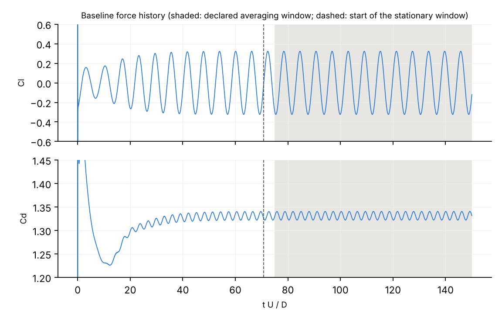

# Baseline validation: 2D cylinder, Re = 100

This report asks two questions:
- Is the baseline case a credible answer to the engineering question?
- What in-house converged reference ("truth") is used to label every benchmark case?

Numbers come from `results/runs/` via `scripts/make_baseline_report.py`. The full generated tables are in
[`baseline_generated.md`](baseline_generated.md); the reference and its chains are in `results/baseline/truth.json`.
The verdicts on the benchmark systems' own baseline graphs (§6) come from the final benchmark results
(`results/benchmark/<system>/baseline.json`; every system complete on 2026-10-20).
Three adversarial fact-checks of earlier drafts led to further study stages (§3) and to corrections throughout.

**Question** (`configs/problem_cylinder_re100.yaml`): the time-mean drag coefficient and the Strouhal number of a
10 mm rod in a uniform 0.15 m/s air stream (Re = 100), per unit span, to within 3 % each. The stream is to be treated
as unbounded.

## 1. Summary

| | mean Cd | St |
|---|---|---|
| baseline (reported, declared averaging window) | 1.3313 | 0.1634 |
| in-house reference T (unbounded domain, h → 0, dt → 0) | **1.3155 ± 0.94 %** | **0.1639 ± 0.46 %** |
| baseline error vs T (point estimate) | +1.20 % | −0.31 % |
| baseline error interval with U(T) | 0.27 % … 2.14 % | 0 … 0.77 % |
| literature band (research.md §2.3, finite domains) | 1.31–1.33 | 0.164–0.166 |

- **Drag: plausibly credible, not demonstrably.**
  - The baseline's best-estimate drag error (+1.20 %) is within τ/2 = 1.5 %.
  - The interval [0.27 %, 2.14 %] straddles τ/2, so under the pre-registered uncertainty mitigation its label is
    ambiguous. Under the §19 rule applied verbatim (point estimates) it is credible. That verbatim label depends on
    the stage-4 choice of domain chain (§3): with the standard-far-field chain (T = 1.3046) the baseline's drag error
    would be 2.04 % and its label ambiguous.
  - The interval stays below τ, so the baseline's drag meets the requested 3 % for every reference value inside U(T).
  - St (−0.31 %) is well within τ/2.
- **The reference is consistent with the literature within about 1 %.**
  - T_Cd lies inside the narrow literature drag band. T_St lies 0.04 % below the St band.
  - At matched domain size, this work is within −0.1 … +0.8 % of the published drag values and −0.2 … +0.3 % of the St
    values (§5). About 1 % of scatter between codes remains, and it limits how precisely the literature can confirm T.
  - The literature cannot test the far-field decision of stage 4. At the literature's domain sizes the refined and
    standard chains agree to 0.04 %; they differ only when extrapolated beyond them.
- **Building this reference took four stages, and the drag value moved by up to 2 %.** The largest single lesson:
  the EXPAND_DOMAIN primitive coarsens the far field as it enlarges the domain, and that confounds a domain study
  (§3). The reference uncertainty carries this as a model-form term.
- **Success criteria.**
  - 2a (pre-registered) is met: the baseline's Cd and St lie within the literature band widened by τ.
  - 2b asks that the baseline's own verification bound the numerical uncertainty below τ, "or the report explains
    why not". On the full-study graph (baseline + 11 study runs, §6) the pre-registered verifier does *not* bound the
    drag uncertainty: it returns INCONCLUSIVE for drag, because the drag domain component (component U = 2.62 %, from
    the coarse-far-field domain chain) exceeds τ/2. It ACCEPTs St (combined U 1.86 %). The drag components themselves
    add up to less than τ (averaging bias 0.007 % plus the RSS of statistics, mesh 0.85 %, time 0.65 % and domain
    2.62 % gives 2.83 %). What fails is the verifier's limit of τ/2 per component, and this report reads 2b through
    that rule. On that graph 2b is met only through its fallback clause; §6 explains why.
  - The verifier did bound both quantities in one of the system graphs built for the baseline case, not in the
    full-study graph. C-llm-r3, the third of three runs of the LLM planner, ACCEPTed the baseline, both quantities
    and so the case: Cd combined U 1.87 % (mesh 0.86 %, time 1.10 %, domain 1.23 %), St 1.59 % (mesh 1.33 %, time
    0.31 %, domain 0.79 %). The baseline's errors against T (+1.20 %, −0.31 %) lie inside these U, so the ACCEPT is
    correct on point estimates; with the mitigation the baseline is ambiguous and the ACCEPT is not scored.
  - That bound does not reproduce. The other two LLM runs, the rule planner (C-rule, and C-rule-prereg with the same
    graph) and Bexh leave drag INCONCLUSIVE on the domain component, with component U from 1.74 % to 3.89 %. The
    accepting graph's domain chain stops at ×2 (half-height 40, 60, 80 D), and its two enlarged levels are 80 D/U
    runs: the ×2 run had not settled (Cd 1.32259 against 1.32189 settled), and the ×1.5 run has no continuation, so
    whether it had settled is not known. The drag observed order on that chain (how fast Cd approaches its limit as
    the domain grows, estimated from three levels) is 1.55; the other planner graphs give 0.82–0.94. All of these
    orders lie inside the band where the Celik safety factor is 1.25 (§4), so the factor is the same in every graph.
    A higher order puts the extrapolated limit closer to the root, and that alone gives the smaller U. With the
    settled value of its ×2 level the same estimate gives 1.97 %: INCONCLUSIVE. The values below 2.62 % come mainly
    from unsettled levels, not from better evidence (§6). The K2 ACCEPT (C-llm-r2) shares this: with its ×2 run's
    180 D/U continuation in place of the 80 D/U value, its drag domain component gives 2.61 %: INCONCLUSIVE (§6).

## 2. Case set-up

| item | choice | note |
|---|---|---|
| domain | 30 D upstream, 50 D downstream, ±40 D laterally (blockage 1.25 %) | the domain study (§3) estimates a −1.2 % drag correction to an unbounded stream (−2.0 % with the standard-far-field chain; the difference is carried in U(T)); inlet, outlet and side distances were varied together, so the study cannot say which dominates; Behr et al.'s lateral-only data suggest the sides are not the main term |
| mesh | 30,580 hexahedra; O-grid with 160 cells around the cylinder; first cell 0.005 D, radial growth 1.07 | about 12 cells inside D/√Re = 0.1 D |
| solver | `pimpleFoam` in PISO mode (1 outer, 2 pressure correctors) | |
| schemes | backward (BDF2) time; `linearUpwind` convection; linear gradients and Laplacian | second-order formal accuracy |
| time step | 0.01 D/U (max Courant number 0.73; about 612 steps per shedding period) | |
| run length | 150 D/U; declared averaging window 75–150 D/U (11 cycles) | |
| boundary conditions | uniform inlet; `inletOutlet` velocity and fixed pressure at the outlet; free-slip (`symmetryPlane`) sides; no-slip cylinder | |
| shedding trigger | `setFields` cross-flow perturbation in the near wake | |

Diagnostics:
- checkMesh: Mesh OK (non-orthogonality 43°, skewness 0.53, aspect ratio 21).
- Final pressure solve converged in 100 % of steps; continuity errors 5e-14; boundary mass imbalance 8e-11.
- 12 stationary cycles; 95 % CI of mean Cd 2.3e-5.
- A further 100 D/U (`baseline.long250`, 23 cycles) changes the stationary Cd and St by 0.002 %.

## 3. Verification study: one factor at a time, four stages

Every level was initialised by mapping a periodic state:
- the mesh levels, dt/2 and dt/4 branch from the baseline;
- dt/8 was mapped from dt/4;
- the ×2 domain level was mapped from the baseline, and the ×3 and ×4 levels from ×2.

Mapped levels first run 80 D/U. MSER hit its 50 % cap on every 80 D/U mapped level, so their "stationary window" is
simply the second half of the record; stationarity is judged from the drift and half-window measures. The far-field
test runs (mapped, 120–200 D/U) did not hit the cap. The reference uses each
member's longest continuation. Child run names record only the step's own factor: the ×4 run is
`baseline.D2x-4312…`, and the domain continuations are `baseline.long180/200/280-…`.

| stage | added | why |
|---|---|---|
| 1 | mesh f = √2, 2; dt/2, dt/4; domain ×2, ×4; baseline +100 D/U | pre-registered one-factor chains |
| 2 | domain ×2 → 180 D/U and ×4 → 280 D/U; dt/8 | the domain levels had not reached a limit cycle in 80 D/U (the wake had not crossed the enlarged domain); St time behaviour unresolved |
| 3 | domain ×3 (half-height 120 D) → 200 D/U | test the conditioning of the domain extrapolation |
| 4 | the ×4 domain, and the ×1 domain as a control, with outer-block cell counts ×1.5 (`scripts/farfield_resolution_test.py`) | the four-level chain did not converge like a power law |

Stage 2 effects:
- ×2 settled at Cd 1.32189 (1.32259 at 80 D/U).
- ×4 settled at 1.31577 (1.31789 at 80 D/U). Its per-cycle mean varies by about 3 × 10⁻⁵ over the last 120 D/U.

**Stage 3 showed the domain chain was not asymptotic.** Cd at half-height 40 / 80 / 120 / 160 D was 1.33117 / 1.32189 /
1.31815 / 1.31577. The slope dCd/d(1/half-height) *grew* as the domain grew (0.74, 0.90, 1.15). Extrapolations from
the finest and from the coarsest three levels differed by 1.3 %.

**Stage 4 points to the cause.**
- EXPAND_DOMAIN keeps the near-field mesh and the per-cell growth rate, so the far field coarsens as the domain
  grows. The last wake cell is about 1.0 D at ×1, 2.0 D at ×2 and 3.9 D at ×4.
- On the ×4 domain, multiplying the cell counts of the outer blocks by 1.5 (97k cells, settled after about 65 D/U,
  19 cycles) raised Cd by 0.16 % (1.31577 → 1.31785) and Cl rms by 2.1 %. St changed by 0.02 %.
- Those outer blocks start at the near-field square, so the refinement also refines the wake inside the baseline's
  own extent. A control run applies the same ×1.5 refinement to the baseline-size (×1) domain. There it changes Cd by
  only +0.03 %, St by +0.04 % and Cl rms by −0.08 %. So about 80 % of the ×4 drag change, and nearly all of the
  Cl rms change, comes from the coarse far field beyond the baseline's extent. The remaining ~0.03 % is wake
  resolution that the mesh chain already counts; removing it would shift the domain extrapolation by about 0.1 %,
  well inside the far-field model-form term (§4).
- With the refined ×4 member, the observed orders are 1.20 (Cd) and 1.30 (St), close to the first-order decay
  expected of far-field disturbances. Inlet, outlet and side distances were varied together, so this does not
  identify blockage specifically. The member was replaced after the chain had been seen, so this is consistency,
  not confirmation.

| factor | values used, Cd | values used, St | observed order (Cd / St) | correction (Cd / St, relative to the baseline) |
|---|---|---|---|---|
| mesh, h = 0.457 → 0.323 → 0.229 D (30.6k → 61.4k → 122.3k cells) | 1.3312 → 1.3359 → 1.3377 (after the time-overlap shift) | 0.1634 → 0.1644 → 0.1647 (shifted) | 2.69 / 2.88 | +0.58 % / +0.92 % |
| time, dt = 0.005 → 0.0025 → 0.00125 (finest three of four) | 1.3275 → 1.3258 → 1.3250 | 0.16356 → 0.16367 → 0.16372 | 1.03 / 1.00 | −0.52 % / +0.21 % |
| domain, half-height 40 → 80 → 160 D (×4 with refined far field) | 1.3312 → 1.3219 → 1.3178 | 0.1634 → 0.1626 → 0.1623 | 1.20 / 1.30 | −1.24 % / −0.81 % |

What else the study shows, and what it does not:

- **The mesh–time overlap.** REFINE_MESH holds the Courant number, so the finer meshes ran at a smaller dt (0.0087 and
  0.0061). Each mesh level is shifted to the baseline dt with the time chain's error model C·dt^p before
  extrapolation.
  - The raw Cd mesh chain is flat after one refinement (1.3349 → 1.3349). The Cd mesh order (2.69) and correction
    (+0.58 %) are therefore implied by the shift, not measured directly.
  - The shift assumes the time error does not depend on the mesh, and an accidental pair of runs contradicts that
    in part. Two f = 2 runs with different dt (0.0075 from the rule planner, 0.0061 from the study) show a dt
    sensitivity of only 66 % (Cd) and 13 % (St) of the baseline-mesh model.
  - The shift's full effect (+0.30 % Cd, −0.16 % St) is therefore carried as a model-form term in U(T). Without the
    shift, T_Cd would be 1.3115.
  - Only the net mesh + time correction (+0.06 % for Cd) is robust. Its split into +0.58 % and −0.52 % is not.
- **Time convergence is first order (observed 1.0–1.1 for Cd, St and Cl rms), not second order.**
  - The cause has not been identified.
  - With one outer corrector, candidates are the convecting face flux lagged from the old time level and the
    ddtCorr flux correction. A run with converged outer iterations would test only the first. ddtCorr acts in every
    pressure corrector and needs its own test.
  - Before dt/8 was added, St barely changed between halvings: apparent order about 0.2 from dt = 0.01 to 0.0025. A
    dt-independent error cannot explain this, because it cancels in differences. Competing first- and second-order
    terms can.
  - The extrapolation from the coarser three time levels differs by 0.36 % (St) and is carried as a conditioning
    term.
- **The time-step trends are opposite to the main literature source.** As dt decreases, Cd and Cl rms fall and St
  rises here. Qu et al. (Crank–Nicolson) report the opposite trend for all three. The time corrections in T depend on
  this solver-specific behaviour.
- **Mesh refinement raises St and Cl rms.** Reduced numerical dissipation on finer meshes is one possible
  explanation; it was not tested.
- **checkMesh flags every enlarged domain.** The ×2, ×3, ×4 and refined ×4 domain meshes fail checkMesh's
  `-allGeometry` determinant check (152 / 216 / 264 / 228 cells), the same check that fails case J1.
  - `scripts/locate_flagged_cells.py` locates them (`results/posthoc/flagged_cells.txt`; ×2 and ×4 meshes, and J1).
  - In the ×2 and ×4 meshes the flagged cells sit 57–155 D from the cylinder: at the far-field corners and sides,
    and on the inlet-side centreline.
  - In J1 all 48 flagged cells sit at x ≈ 47 D, next to the outlet.
  - The determinant flag reacts to stretched cells far from the body, and is unlikely to affect the forces itself.
    Far-field resolution does affect them (stage 4), but by tenths of a percent, not the errors that matter at τ.
    J1 is rejected by every system because of this flag (§7).

## 4. In-house reference T

T = baseline value + the sum of the per-factor corrections. This additive one-factor model is an assumption of this
work, in the style of Stern et al. (2001). Each chain is extrapolated with the Celik et al. (2008) procedure:
- Fs = 1.25 when the observed order lies within [0.5, 2]× the formal order;
- otherwise p = min(observed, formal) with Fs = 3. That rule comes from review corrections R4/E1; the pre-registered
  text said "formal order".

U(T) combines, by root-sum-square:
- each chain's discretisation uncertainty;
- the statistical uncertainty of each chain's finest and middle members, carried through the extrapolation weights,
  plus the root's once;
- three model-form or conditioning terms.

| term (relative to T) | Cd | St |
|---|---|---|
| domain extrapolation (Fs·\|ext − finest\|) | 0.30 % | 0.17 % |
| **far-field model form**: the refined-×4 chain against the standard chain (1.31472 vs 1.30389) | **0.82 %** | 0.07 % |
| time-overlap model form (full effect of the shift) | 0.30 % | 0.16 % |
| time conditioning (finest vs coarser three levels) | 0.02 % | **0.36 %** |
| mesh, time extrapolation | 0.11 %, 0.08 % | 0.15 %, 0.04 % |
| statistics of the members | 0.01 % | 0.02 % |
| **U(T)** | **0.94 %** | **0.46 %** |

The far-field term is the gap between the refined and standard three-level chains. It covers the possibility that
the stage-4 change was entirely a mesh effect and the standard chain applies (T = 1.3046); the ×1 control makes that
unlikely. It is not derived from a model of the residual far-field error:
- the ×2 level's own far-field bias was not measured;
- one refinement of the ×4 far field does not show far-field convergence;
- it does not cover the stage-3 four-level standard-chain result (1.290), which the far-field diagnosis explains
  rather than bounds.

**History of the reference.** Every committed version of `results/baseline/truth.json`, and the
`benchmark/labels.json` version computed from it (commit times UTC, 2026-10-19):

| version | truth.json commit | labels commit | Cd | St | what changed |
|---|---|---|---|---|---|
| stage 1 | 0cb34f0 (11:02) | 3d9f43c (11:03) | 1.3133 ± 0.72 % | 0.1647 ± 1.06 % | pre-registered chains; domain levels unsettled (80 D/U) |
| stage 1, root continued | ce815d6 (11:23) | 3cff05d (12:42) | 1.3134 ± 0.71 % | 0.1648 ± 1.29 % | root value from its 250 D/U continuation; other members unchanged (commit titled stage 2: the stage-2 runs were launched; truth.json changed only the root value); St U rises because the St time order falls from 0.25 to 0.21 |
| stage 2 | 33d5ebf (13:25) | 33d5ebf | 1.3046 ± 1.15 % | 0.1638 ± 0.28 % | settled domain levels; dt/8 |
| stage 2, model-form terms | 4776198 (13:51) | not recomputed | 1.3046 ± 1.19 % | 0.1638 ± 0.48 % | time-overlap model-form term; time conditioning term |
| stage 3 (four-level domain chain, standard far field) | 26fee11 (14:26) | not recomputed | 1.290 ± 6.3 % | 0.1641 ± 0.84 % | the domain chain is not asymptotic |
| **stage 4 (final)** | 021fc5a (16:43) | 021fc5a | **1.3155 ± 0.94 %** | **0.1639 ± 0.46 %** | far-field-refined ×4 level; far-field model-form term |

The revisions were not made blind to the benchmark. Labels and rates were first computed against the stage-1
reference (3d9f43c, which also wrote `reports/benchmark_tables.md` and `results/benchmark/metrics.json`). The
handoff document committed at 4b2a419 (13:13) interpreted benchmark verdicts and case errors under the 3cff05d
labels (its §39, "findings so far"), before the stage 2–4 references were committed. The stated reason for each
later stage is a diagnostic of the study itself (stage table in §3), and no verdict uses T. What the revisions can
and cannot have changed (recomputed from the `reported` values in `benchmark/labels.json` and each version's
`truth`):
- On point estimates (§19 rule verbatim), the flawed set is identical under every committed labels version:
  A1, B1, B2, C2, D1, F1, H1, I1.
- The credible set changes: baseline, C1, K2 (3d9f43c, 3cff05d); A2, C1, G2, J1 (33d5ebf); A2, C1, J1, K2,
  baseline (021fc5a).
- So, on point estimates, the false-acceptance and detection rates do not depend on the revisions, while the
  correct-acceptance and false-rejection rates do.
- With the mitigation (§7), the stored label sets are the same in all four labels versions: A1, B1, B2, D1, F1,
  H1, I1 flawed, no case credible, the rest ambiguous; so in the mitigated view no rate depends on the revisions.

**Cl rms (not a requested quantity) has no reliable reference.** With the standard ×4 level its domain chain
diverges. With the refined ×4 level it extrapolates to 0.2217, and the time-overlap shift moves it by 2.4 %. No value
is used in any verdict or label.

## 5. Validation against the literature

The literature values come from finite domains, so a like-for-like comparison evaluates this work's (refined) domain
chain at each source's lateral extent. The fit is Cd = 1.3147 + 1.365·(1/half-height)^1.20, at the baseline mesh and
time step, plus the net mesh and time correction (+0.06 %). The literature values are taken as published; they are
not converged, and Qu et al.'s Δt = 0.02 drag is about 0.3 % low by their own time-step study. Inlet and outlet
proportions differ between the studies, and Posdziech & Grundmann's primary values are unverified (research.md §8).

| source | domain (full height) | source Cd | this work at the same lateral extent | difference |
|---|---|---|---|---|
| Posdziech & Grundmann 2007 | H = 140 D | 1.325 | 1.324 | −0.1 % |
| Mittal 2005 (slip sides) | H = 100 D | 1.322 | 1.328 | +0.5 % |
| Qu et al. 2013 D3 / D2 / D1 (Dirichlet sides, Δt = 0.02) | H = 100 / 120 / 200 D | 1.317 / 1.315 / 1.310 | 1.328 / 1.326 / 1.321 | +0.8 % (≈ +0.5 % after Qu's own Δt correction) |

| St source | domain | source St | this work at the same lateral extent | difference |
|---|---|---|---|---|
| Qu et al. 2013 D1 | H = 200 D | 0.1647 | 0.1643 | −0.2 % |
| Posdziech & Grundmann 2007 | H = 140 D | 0.1644 | 0.1646 | +0.1 % |
| Mittal 2005 | H = 100 D | 0.1644 | 0.1649 | +0.3 % |
| Williamson 1989 fit (experiments, unbounded) | — | 0.1643 | T = 0.1639 | −0.2 % |

What the comparison can and cannot say:
- Qu et al.'s domain series extrapolated to an unbounded domain gives Cd ≈ 1.302 and St ≈ 0.1644. Rounding of the
  three-decimal published values alone allows 1.286–1.307 for that drag extrapolation, so it cannot confirm T to
  better than about ±1 %. That estimate lies wholly below T_Cd, contains the standard-chain value (1.3046), and is
  consistent with T only through U(T).
- At the literature's domain sizes (H = 100–200 D) the refined and standard chains differ by at most 0.04 %. The
  comparison therefore supports the finite-domain values and the mesh and time corrections to within the ~1 %
  inter-code scatter. It does not test the far-field decision, nor T at the τ/2 level.

## 6. What the deterministic verifier concludes about the baseline

The verifier can only use the primitives, so its domain family uses the standard (coarse-far-field) ×2/×4 levels and
not the refined test run.

| evidence available | Cd | St |
|---|---|---|
| baseline run only (System B) | INCONCLUSIVE (mesh, time, domain not measured) | INCONCLUSIVE |
| baseline + 11 study runs (full-study graph) | **INCONCLUSIVE**: domain component U = 2.62 % > τ/2 | **ACCEPT** (combined U 1.86 %) |

| component (full-study graph) | Cd | St |
|---|---|---|
| averaging, statistics | PASS | PASS |
| mesh | 0.85 % PASS | 1.33 % PASS |
| time | 0.65 % PASS | 0.67 % PASS |
| domain | **2.62 % INCONCLUSIVE** | 1.12 % PASS |

Each uncertainty component (statistics, mesh, time, domain) PASSes only if its U ≤ τ/2. The averaging component is
a measured bias and PASSes if it is ≤ τ. The combined U (the averaging bias plus the root-sum-square of the
uncertainty components, design §13) is formed only when every component PASSes, and must be ≤ τ. The drag domain
component PASSes in only one graph in this section (C-llm-r3's, below), so that is the only graph with a drag
combined U.

C-rule, C-llm, C-llm-r2, C-llm-r3 and Bexh built their own, smaller graphs for the baseline case
(`results/benchmark/<system>/baseline.json`, verifier `per_qoi`); C-rule-prereg built exactly C-rule's graph. A and
L-judge build no verifier graph, and B's single-run graph has no domain level (first table above). The full-study
domain chain uses the settled continuations (`baseline.long250`, `baseline.long180`, `baseline.long280`).

| graph | Cd domain levels (half-height) | Cd domain observed order; Fs | Cd domain component U | Cd | St |
|---|---|---|---|---|---|
| full study (above) | 40, 80, 160 D (settled) | 0.60; 1.25 | 2.62 % | INCONCLUSIVE | ACCEPT (combined U 1.86 %) |
| C-rule (= C-rule-prereg) | 40, 80, 160 D | 0.86; 1.25 | 1.81 % | INCONCLUSIVE | ACCEPT (combined U 1.59 %) |
| C-llm | 40, 80, 120, 160 D | 0.94; 1.25 | 1.74 % | INCONCLUSIVE | INCONCLUSIVE (domain component 1.85 %) |
| C-llm-r2 (repeat) | 40, 60, 80, 120 D | 0.82; 1.25 | 1.88 % | INCONCLUSIVE | INCONCLUSIVE (domain component 1.59 %) |
| **C-llm-r3 (repeat)** | 40, 60, 80 D | 1.55; 1.25 | **1.23 % (PASS)** | **ACCEPT (combined U 1.87 %)** | **ACCEPT (combined U 1.59 %)** |
| Bexh (one domain level: two-level estimate, p = 1, Fs = 3) | 40, 80 D | —; 3 | 3.89 % | INCONCLUSIVE | INCONCLUSIVE (domain component 2.63 %) |

Every drag domain component except C-llm-r3's is above τ/2 = 1.5 %.

The C-rule, C-llm, C-llm-r2 and C-llm-r3 values are lower than the same estimates on settled levels because their
domain levels are the 80 D/U EXPAND_DOMAIN runs, which had not settled (×2 1.32259 against 1.32189 settled, ×3 1.31943 against 1.31815, ×4 1.31789 against
1.31577; §3 stages 2–3, §8 "Mapped initialisation"), not because their evidence is better. The three-level estimate
uses the root and the two largest domains of each chain: ×2 and ×4 for C-rule (observed order 0.86, against 0.60
with the settled values); ×3 and ×4 for C-llm, whose chain also has ×2; ×2 and ×3 for C-llm-r2, whose chain also
has ×1.5 and stops at ×3 (half-height 120 D); ×1.5 and ×2 for C-llm-r3, whose chain stops at ×2 (half-height
80 D). With the settled values of the same levels, the same estimate gives 2.62 % (C-rule), 7.15 % (C-llm:
observed order 0.49, just below the band, so Fs = 3) and 2.40 % (C-llm-r2; it stays below 2.62 % only because that
chain stops at ×3). C-llm-r3's ×1.5 level (`baseline.D1.5x-c018e6157314`, Cd 1.32508) has no settled continuation;
replacing only its ×2 value (1.32259) by the settled one (1.32189) gives order 0.85 and U 1.97 %: INCONCLUSIVE
(computed for this report with `checks/sensitivity.assess_sequence` on the stored values and noise). Bexh
has one domain level (the 80 D/U ×2 run), with `baseline.long250` as its root member.

**C-llm-r3's ACCEPT** (`results/benchmark/C-llm-r3/baseline.json`; 5 experiments, 7.12× the root's compute).
- Every component of both quantities PASSes. Cd: averaging bias 0.009 %, statistics 0.008 %, mesh 0.86 %, time
  1.10 %, domain 1.23 %; combined U 1.87 %. St: averaging 0.002 %, statistics 0.007 %, mesh 1.33 %, time 0.31 %,
  domain 0.79 % (observed order 1.68); combined U 1.59 %. The case is ACCEPTed.
- Against T the errors are +1.20 % (Cd) and −0.31 % (St), inside U: correct on point estimates. With the
  truth-uncertainty mitigation (§7) the baseline is ambiguous, so the ACCEPT is not scored.
- Its three domain runs are also in C-llm-r2's graph. C-llm-r2 added a ×3 level (`baseline.D1.5x-ed421affd588`,
  ×1.5 from ×2); with that level the estimate moves to the ×2 and ×3 members, the order to 0.82 and U to 1.88 %.
- So the ACCEPT turns on the observed order of the drag domain chain. Every three-level planner chain in the table
  has Fs = 1.25, so on this case the order acts through the extrapolation: a higher order puts the extrapolated
  limit closer to the root, so U is smaller (1.23 % at order 1.55 against 1.74–1.88 % at 0.82–0.94). It does not act
  through the Celik safety factor (1.25 inside [0.5, 2] × the formal order, 3 outside, §4), which switches only on
  K2 (C-llm and C-llm-r3, orders 2.79 and 7.66). The order moves with the levels the planner chose and with how far
  those levels had settled. On this case the accepting chain is the shorter one. That is not the general mechanism:
  on K2 the accepting C-llm-r2 chain ends at ×3, and C-rule's chain to ×4 also passes its domain component
  (`docs/methodology.md` §8, "Observations"). What the two ACCEPTs share is an unsettled 80 D/U ×2 run: on K2,
  replacing that run's Cd (`K2_fine_large.D2x-bc527461f36d`, 1.32076) by its 180 D/U continuation
  (`K2_fine_large.long180-dda8a9c17278`, 1.31963) gives C-llm-r2's chain order 2.51, outside the band, so Fs = 3
  and U 2.61 %: INCONCLUSIVE (computed with `checks/sensitivity.assess_sequence` on the stored values and noise; the
  same substitution in C-rule's K2 chain gives order 2.63 and U 2.45 %).
- It is 1 of 3 LLM runs on this case, and it does not reproduce: C-llm and C-llm-r2 end INCONCLUSIVE on the same
  case, as do C-rule, C-rule-prereg and Bexh.

Reading this:
- **The verifier's domain component U for Cd is inflated by the far-field confound** (stage 4 and its ×1
  control). U = 1.25 × the root's estimated domain error from the standard chain, 2.09 % relative to the
  extrapolated value, which gives 2.62 %. From the refined chain it would be 1.25 × 1.25 % = 1.56 %. That is still
  just above τ/2, so the domain component would remain INCONCLUSIVE.
- **On the full-study chain the verifier cannot ACCEPT this drag within the primitives.** ×4 is EXPAND_DOMAIN's hard
  limit, so no further step is available, and even the refined chain would give U above τ/2.
- **A different choice of levels can, without better evidence.** C-llm-r3's chain stops at ×2 on 80 D/U members
  (the ×2 one unsettled) and passes; the settled ×2 value alone turns it back to INCONCLUSIVE (1.97 %). Its ACCEPT
  therefore shows
  that the verdict on the same case depends on which levels a planner builds, not that the baseline's drag error is
  bounded below τ/2 by the domain evidence. An acceptance rule that does not depend on that choice was not
  pre-registered and was not tested (final report, Q12 "What to build next").
- **The confound is a design flaw of the EXPAND_DOMAIN primitive, not of the decision rule.** It makes the verifier
  conservative here: it inflates the domain change, which is safe for acceptance. It could also inflate a domain FAIL
  on a borderline case. A primitive that enlarges the domain at constant far-field resolution should replace it
  (final report, Q12 "What to build next").
- **The verifier's U exceeding the reference's corrections is not independent evidence of correctness.** The two use
  the same runs. U = Fs × correction holds by construction for the domain and Cd-time components. For the mesh
  component the margin comes from the verifier's Fs = 3 offsetting the time-overlap shift.

## 7. Consequences for the benchmark labels

Labels use the pre-registered §19 rule, e = |reported − T|/T:
- flawed if e > τ, or if the set-up solves another problem;
- credible if e ≤ τ/2;
- ambiguous otherwise.

The pre-registered risk mitigation ("label near-boundary cases ambiguous") was operationalised in review R18, before
any result, as follows: a case is ambiguous when [e − U(T), e + U(T)] straddles τ or τ/2, unless it is flawed for
every T in that interval. A1, B2 and F1 are flawed through that exception: A1 and F1 because their St errors, and B2
because its drag error, are beyond τ even after subtracting U(T). H1 is flawed by its set-up (it solves Re = 83.3).
The analysis reports both label sets.

| case | Cd error | St error | §19 rule (verbatim) | with the mitigation |
|---|---|---|---|---|
| baseline | +1.20 % | −0.31 % | credible | ambiguous |
| K1 (central scheme) | +1.90 % | | ambiguous (even on point estimates) | ambiguous |
| K2 (finer mesh, larger domain) | +0.94 % | | credible | ambiguous |
| A2, C1, J1 | 0.5–0.64 % | ≤ 1.5 % | credible | ambiguous |
| E1, G1, G2 | | | ambiguous | ambiguous |
| C2 | | 3.33 % | flawed | ambiguous |
| A1, B1, B2, D1, F1, H1, I1 | | | flawed | flawed |

Four consequences:
- With U(T) = 0.94 % (Cd) and 0.46 % (St), the mitigated view can label a case credible only if its drag error is
  below 0.565 % *and* its St error is below 1.04 %. No case meets both: A2, G2 and J1 (0.564 %) meet the drag bound but
  not the St bound. So that view has no credible cases.
- Several cases designed to be flawed are credible or ambiguous at τ = 3 %: C1, J1, G2, G1 and E1, plus C2 under the
  mitigation.
- None of the three cases designed to be credible is robustly credible. K1 is ambiguous even on point estimates
  (Cd 1.90 %). The baseline (1.20 %) and K2 (0.94 %) are credible only on point estimates, and that depends on the
  stage-4 choice: with the standard chain they would be 2.04 % and 1.78 %, both ambiguous.
- On this benchmark, the difference between "plausible but wrong" and "careful" is often smaller than the
  uncertainty of an unbounded-domain reference.

## 8. Limitations

- **Additivity.** The reference assumes additive, independent mesh, time and domain errors, from one-factor chains
  around a single point. The time-overlap shift's mesh dependence is measured at only one mesh, and only partly.
- **Far field.** The far-field model-form term rests on one refinement of one domain level, plus one control at
  ×1. A domain chain at constant far-field resolution is the clean fix.
- **Mapped initialisation.** It was assumed to reach the same limit cycle as a fresh start; this was not tested.
  Mapped domain levels needed 100–150 D/U to settle, far more than the 80 D/U the primitives give mapped children.
  That is another primitive design issue: the verifier's domain levels for the benchmark cases are 80 D/U runs.
  C-llm-r3's ACCEPT of the baseline rests on two such levels; with the settled ×2 value it would not pass (§6).
- **Time convergence.** It is first order for unidentified reasons, with trends opposite to Qu et al.
- **Reproduction.** Single-core runs are bitwise reproducible (methodology §9). The reference has not been reproduced
  with a second code.
