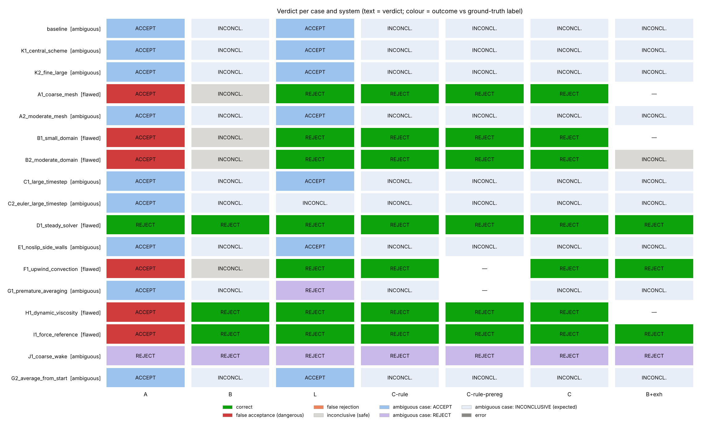
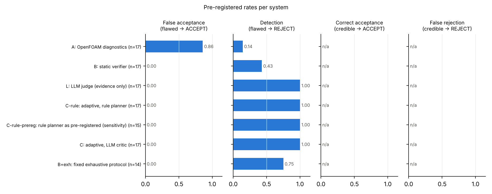
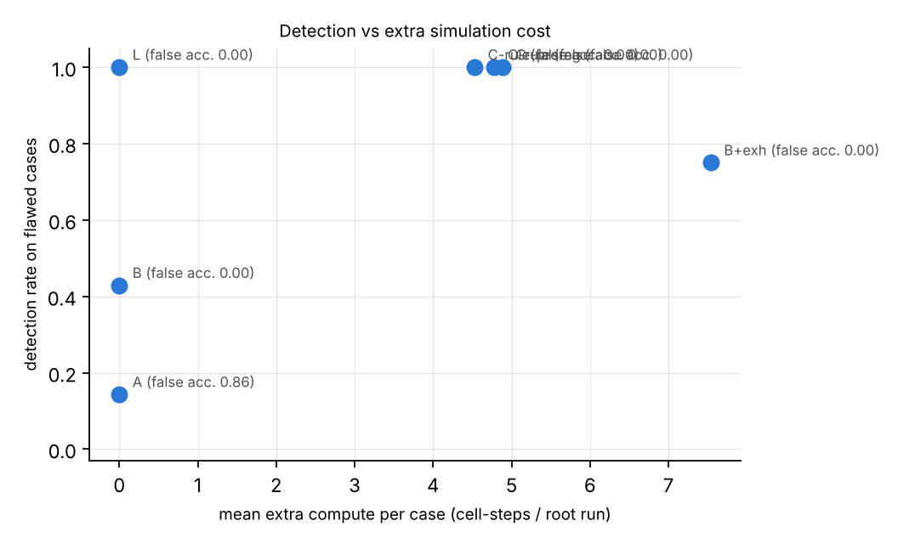

# Benchmark results

_Generated by `scripts/make_reports.py` from `results/`. Interpretation: `reports/final_report.md`._

## Ground truth

In-house converged reference (baseline one-factor refinement chains, Richardson-extrapolated; `reports/baseline_validation.md`): mean_drag_coefficient = 1.3155 (±0.94%), strouhal_number = 0.1639 (±0.46%).

Labelling rule (pre-registered): flawed if max error > tau or set-up answers a different problem; credible if max error <= tau/2; else ambiguous; label unstable under the truth uncertainty → ambiguous.

| case | intended | measured label | reported Cd | reported St | err Cd | err St | note |
|---|---|---|---|---|---|---|---|
| baseline | credible | **ambiguous** | 1.331 | 0.1634 | 1.2% | 0.308% | label unstable under the truth uncertainty: mean_drag_coefficient |
| K1_central_scheme | credible | **ambiguous** | 1.34 | 0.1633 | 1.9% | 0.395% | label unstable under the truth uncertainty: mean_drag_coefficient |
| K2_fine_large | credible | **ambiguous** | 1.328 | 0.1638 | 0.941% | 0.0729% | label unstable under the truth uncertainty: mean_drag_coefficient |
| A1_coarse_mesh | flawed | **flawed** | 1.295 | 0.1556 | 1.55% | 5.08% |  |
| A2_moderate_mesh | ambiguous | **ambiguous** | 1.322 | 0.1616 | 0.506% | 1.45% | label unstable under the truth uncertainty: strouhal_number |
| B1_small_domain | flawed | **flawed** | 1.509 | 0.1796 | 14.7% | 9.57% |  |
| B2_moderate_domain | ambiguous | **flawed** | 1.371 | 0.167 | 4.24% | 1.89% |  |
| C1_large_timestep | flawed | **ambiguous** | 1.324 | 0.1635 | 0.637% | 0.261% | label unstable under the truth uncertainty: mean_drag_coefficient |
| C2_euler_large_timestep | flawed | **ambiguous** | 1.29 | 0.1585 | 1.93% | 3.33% | label unstable under the truth uncertainty: mean_drag_coefficient,strouhal_number |
| D1_steady_solver | flawed | **flawed** | 1.092 | — | 17% | —% | steady formulation of a periodic flow; requested quantities not produced: ['strouhal_number'] |
| E1_noslip_side_walls | flawed | **ambiguous** | 1.34 | 0.1643 | 1.89% | 0.212% | label unstable under the truth uncertainty: mean_drag_coefficient |
| F1_upwind_convection | flawed | **flawed** | 1.269 | 0.1261 | 3.55% | 23.1% |  |
| G1_premature_averaging | flawed | **ambiguous** | 1.296 | 0.1613 | 1.47% | 1.62% | label unstable under the truth uncertainty: mean_drag_coefficient,strouhal_number |
| H1_dynamic_viscosity | flawed | **flawed** | 1.349 | 0.154 | 2.52% | 6.05% | solves Re=83.33 instead of 100 |
| I1_force_reference | flawed | **flawed** | 1.17 | 0.1634 | 11.1% | 0.308% |  |
| J1_coarse_wake | flawed | **ambiguous** | 1.323 | 0.1621 | 0.564% | 1.11% | label unstable under the truth uncertainty: strouhal_number |
| G2_average_from_start | flawed | **ambiguous** | 1.32 | 0.1614 | 0.318% | 1.52% | label unstable under the truth uncertainty: strouhal_number |

## Verdicts and pre-registered rates

**Missing or stale results (NOT counted in the rates of the system concerned; recompute before drawing conclusions):** C-rule-prereg/F1_upwind_convection: missing; C-rule-prereg/G1_premature_averaging: missing; Bexh/A1_coarse_mesh: missing; Bexh/B1_small_domain: missing; Bexh/H1_dynamic_viscosity: missing

_Percentages: errors against the reference T are relative to T. Verifier sensitivity changes are relative to the finer (child) member of a study, |q_fine − q_root| / |q_fine| (checks/sensitivity.py; the finest member for a three-level chain). Observation lines in the case reports (reports/cases/) and the loop traces in benchmark_results.md are relative to the parent run, (q_child − q_parent) / q_parent._

| case | label (with mitigation) | max err / τ | unstable | label without mitigation | A | B | L-judge | C-rule | C-rule-prereg | C-llm | Bexh |
|---|---|---|---|---|---|---|---|---|---|---|---|
| baseline | ambiguous | 0.40 | mean_drag_coefficient | credible | ACCEPT ~ | INCONCLUSIVE ~· | ACCEPT ~ | INCONCLUSIVE ~· | INCONCLUSIVE ~· | INCONCLUSIVE ~· | INCONCLUSIVE ~· |
| K1_central_scheme | ambiguous | 0.63 | mean_drag_coefficient | ambiguous | ACCEPT ~ | INCONCLUSIVE ~· | ACCEPT ~ | INCONCLUSIVE ~· | INCONCLUSIVE ~· | INCONCLUSIVE ~· | INCONCLUSIVE ~· |
| K2_fine_large | ambiguous | 0.31 | mean_drag_coefficient | credible | ACCEPT ~ | INCONCLUSIVE ~· | ACCEPT ~ | INCONCLUSIVE ~· | INCONCLUSIVE ~· | INCONCLUSIVE ~· | INCONCLUSIVE ~· |
| A1_coarse_mesh | flawed | 1.69 |  | flawed | ACCEPT ✗✗ | INCONCLUSIVE · | REJECT ✓ | REJECT ✓ | REJECT ✓ | REJECT ✓ | — ? |
| A2_moderate_mesh | ambiguous | 0.48 | strouhal_number | credible | ACCEPT ~ | INCONCLUSIVE ~· | ACCEPT ~ | INCONCLUSIVE ~· | INCONCLUSIVE ~· | INCONCLUSIVE ~· | INCONCLUSIVE ~· |
| B1_small_domain | flawed | 4.90 |  | flawed | ACCEPT ✗✗ | INCONCLUSIVE · | REJECT ✓ | REJECT ✓ | REJECT ✓ | REJECT ✓ | — ? |
| B2_moderate_domain | flawed | 1.41 |  | flawed | ACCEPT ✗✗ | INCONCLUSIVE · | REJECT ✓ | REJECT ✓ | REJECT ✓ | REJECT ✓ | INCONCLUSIVE · |
| C1_large_timestep | ambiguous | 0.21 | mean_drag_coefficient | credible | ACCEPT ~ | INCONCLUSIVE ~· | ACCEPT ~ | INCONCLUSIVE ~· | INCONCLUSIVE ~· | INCONCLUSIVE ~· | INCONCLUSIVE ~· |
| C2_euler_large_timestep | ambiguous | 1.11 | mean_drag_coefficient,strouhal_number | flawed | ACCEPT ~ | INCONCLUSIVE ~· | INCONCLUSIVE ~· | INCONCLUSIVE ~· | INCONCLUSIVE ~· | INCONCLUSIVE ~· | INCONCLUSIVE ~· |
| D1_steady_solver | flawed | 5.66 |  | flawed | REJECT ✓ | REJECT ✓ | REJECT ✓ | REJECT ✓ | REJECT ✓ | REJECT ✓ | REJECT ✓ |
| E1_noslip_side_walls | ambiguous | 0.63 | mean_drag_coefficient | ambiguous | ACCEPT ~ | INCONCLUSIVE ~· | ACCEPT ~ | INCONCLUSIVE ~· | INCONCLUSIVE ~· | INCONCLUSIVE ~· | INCONCLUSIVE ~· |
| F1_upwind_convection | flawed | 7.69 |  | flawed | ACCEPT ✗✗ | INCONCLUSIVE · | REJECT ✓ | REJECT ✓ | — ? | REJECT ✓ | REJECT ✓ |
| G1_premature_averaging | ambiguous | 0.54 | mean_drag_coefficient,strouhal_number | ambiguous | ACCEPT ~ | INCONCLUSIVE ~· | REJECT ~ | INCONCLUSIVE ~· | — ? | INCONCLUSIVE ~· | INCONCLUSIVE ~· |
| H1_dynamic_viscosity | flawed | 2.02 |  | flawed | ACCEPT ✗✗ | REJECT ✓ | REJECT ✓ | REJECT ✓ | REJECT ✓ | REJECT ✓ | — ? |
| I1_force_reference | flawed | 3.68 |  | flawed | ACCEPT ✗✗ | REJECT ✓ | REJECT ✓ | REJECT ✓ | REJECT ✓ | REJECT ✓ | REJECT ✓ |
| J1_coarse_wake | ambiguous | 0.37 | strouhal_number | credible | REJECT ~ | REJECT ~ | REJECT ~ | REJECT ~ | REJECT ~ | REJECT ~ | REJECT ~ |
| G2_average_from_start | ambiguous | 0.51 | strouhal_number | ambiguous | ACCEPT ~ | INCONCLUSIVE ~· | ACCEPT ~ | INCONCLUSIVE ~· | INCONCLUSIVE ~· | INCONCLUSIVE ~· | INCONCLUSIVE ~· |

✓ correct · ✗✗ **false acceptance** · ✗ false rejection · `·` INCONCLUSIVE (safe, undecided) · `~` / `~·` verdict on an ambiguous case (not scored; INCONCLUSIVE expected) · E error · ? missing · S stale (not counted)

| metric | A | B | L-judge | C-rule | C-rule-prereg | C-llm | Bexh |
|---|---|---|---|---|---|---|---|
| cases | 17 | 17 | 17 | 17 | 15 | 17 | 14 |
| flawed cases (decided) | 7 | 7 | 7 | 7 | 6 | 7 | 4 |
| credible cases (decided) | 0 | 0 | 0 | 0 | 0 | 0 | 0 |
| ambiguous cases (decided) | 10 | 10 | 10 | 10 | 9 | 10 | 10 |
| **false acceptance** (flawed → ACCEPT) | 0.86 | 0.00 | 0.00 | 0.00 | 0.00 | 0.00 | 0.00 |
| detection (flawed → REJECT) | 0.14 | 0.43 | 1.00 | 1.00 | 1.00 | 1.00 | 0.75 |
| missed but safe (flawed → INCONCLUSIVE) | 0.00 | 0.57 | 0.00 | 0.00 | 0.00 | 0.00 | 0.25 |
| correct acceptance (credible → ACCEPT) | — | — | — | — | — | — | — |
| false rejection (credible → REJECT) | — | — | — | — | — | — | — |
| inconclusive (all decided) | 0.00 | 0.76 | 0.06 | 0.53 | 0.53 | 0.53 | 0.71 |
| ambiguous cases: verdicts | ACC:9 REJ:1 INC:0 | ACC:0 REJ:1 INC:9 | ACC:7 REJ:2 INC:1 | ACC:0 REJ:1 INC:9 | ACC:0 REJ:1 INC:8 | ACC:0 REJ:1 INC:9 | ACC:0 REJ:1 INC:9 |
| ambiguous cases ACCEPTed although best-estimate error > τ | 1 | 0 | 0 | 0 | 0 | 0 | 0 |
| errors (excluded from rates) | 0 | 0 | 0 | 0 | 0 | 0 | 0 |
| stale results (excluded) | 0 | 0 | 0 | 0 | 0 | 0 | 0 |
| missing results | 0 | 0 | 0 | 0 | 2 | 0 | 3 |
| errors by label | fla:0 cre:0 amb:0 | fla:0 cre:0 amb:0 | fla:0 cre:0 amb:0 | fla:0 cre:0 amb:0 | fla:0 cre:0 amb:0 | fla:0 cre:0 amb:0 | fla:0 cre:0 amb:0 |
| mean extra simulations / case | 0.00 | 0.00 | 0.00 | 3.47 | 3.13 | 3.06 | 4.79 |
| mean extra compute / case (× root) | 0.00 | 0.00 | 0.00 | 4.78 | 4.53 | 4.89 | 7.54 |
| total experiment wall time (h) | 0.00 | 0.00 | 0.00 | 31.73 | 30.06 | 40.17 | 40.93 |
| LLM cost (USD) | 0.00 | 0.00 | 0.54 | 0.00 | 0.00 | 5.13 | 0.00 |
| authority violations | 0 | 0 | 0 | 0 | 0 | 0 | 0 |
| untraceable numbers in LLM text | 0 | 0 | 27 | 0 | 0 | 59 | 0 |
| first experiment targets the flaw | — | — | — | 1/4 | 1/3 | 4/4 | — |

### Labels without the truth-uncertainty mitigation (design.md §19 rule, point estimates)

_Same verdicts; only the labels change. Both label sets are pre-registered: the §19 rule, and the risk mitigation 'label near-boundary cases ambiguous' (design.md, major technical risks 2), operationalised in review R18 (4639ddb, 2026-10-19 08:24 UTC; some verdicts already existed, but no reference T and hence no label did) as 'the interval e ± U(T) straddles τ or τ/2'. The table above uses the mitigation. Both label sets apply the narrow reading of the §19 set-up clauses (see 'Attack cases against the reference'). Under the set-up reading, E1_noslip_side_walls (no-slip side walls where the problem is unbounded; max err 0.63 τ) would be flawed instead of ambiguous, and the ACCEPTs of A and L-judge on it would be false acceptances; no other benchmark label changes (the other cases are flawed by error or have numerical defects only)._

| metric | A | B | L-judge | C-rule | C-rule-prereg | C-llm | Bexh |
|---|---|---|---|---|---|---|---|
| flawed cases | 8 | 8 | 8 | 8 | 7 | 8 | 5 |
| credible cases | 5 | 5 | 5 | 5 | 5 | 5 | 5 |
| ambiguous cases | 4 | 4 | 4 | 4 | 3 | 4 | 4 |
| **false acceptance** | 0.88 | 0.00 | 0.00 | 0.00 | 0.00 | 0.00 | 0.00 |
| detection | 0.12 | 0.38 | 0.88 | 0.88 | 0.86 | 0.88 | 0.60 |
| missed but safe | 0.00 | 0.62 | 0.12 | 0.12 | 0.14 | 0.12 | 0.40 |
| correct acceptance | 0.80 | 0.00 | 0.80 | 0.00 | 0.00 | 0.00 | 0.00 |
| false rejection | 0.20 | 0.20 | 0.20 | 0.20 | 0.20 | 0.20 | 0.20 |

### Calibration: the verifier's uncertainty estimate vs the error against the reference

_Cases where mesh, time and domain all carry an estimate. U = averaging bias + RSS(components). 'within U(T)': not covered by U alone, but by U combined with the reference's own uncertainty._

| case | system | quantity | error vs reference | verifier U | verdict | covered |
|---|---|---|---|---|---|---|
| baseline | C-rule | mean_drag_coefficient | 1.20% | 2.42% | INCONCLUSIVE | yes |
| baseline | C-rule | strouhal_number | 0.31% | 1.59% | ACCEPT | yes |
| K1_central_scheme | C-rule | mean_drag_coefficient | 1.90% | 6.74% | INCONCLUSIVE | yes |
| K1_central_scheme | C-rule | strouhal_number | 0.39% | 2.53% | INCONCLUSIVE | yes |
| K2_fine_large | C-rule | mean_drag_coefficient | 0.94% | 1.47% | ACCEPT | yes |
| K2_fine_large | C-rule | strouhal_number | 0.07% | 2.54% | INCONCLUSIVE | yes |
| A2_moderate_mesh | C-rule | mean_drag_coefficient | 0.51% | 2.40% | INCONCLUSIVE | yes |
| A2_moderate_mesh | C-rule | strouhal_number | 1.45% | 2.74% | INCONCLUSIVE | yes |
| B2_moderate_domain | C-rule | strouhal_number | 1.89% | 3.91% | INCONCLUSIVE | yes |
| E1_noslip_side_walls | C-rule | mean_drag_coefficient | 1.89% | 3.45% | INCONCLUSIVE | yes |
| E1_noslip_side_walls | C-rule | strouhal_number | 0.21% | 2.94% | INCONCLUSIVE | yes |
| baseline | C-rule-prereg | mean_drag_coefficient | 1.20% | 2.42% | INCONCLUSIVE | yes |
| baseline | C-rule-prereg | strouhal_number | 0.31% | 1.59% | ACCEPT | yes |
| K1_central_scheme | C-rule-prereg | mean_drag_coefficient | 1.90% | 6.74% | INCONCLUSIVE | yes |
| K1_central_scheme | C-rule-prereg | strouhal_number | 0.39% | 2.53% | INCONCLUSIVE | yes |
| K2_fine_large | C-rule-prereg | mean_drag_coefficient | 0.94% | 1.47% | ACCEPT | yes |
| K2_fine_large | C-rule-prereg | strouhal_number | 0.07% | 2.54% | INCONCLUSIVE | yes |
| A2_moderate_mesh | C-rule-prereg | mean_drag_coefficient | 0.51% | 2.40% | INCONCLUSIVE | yes |
| A2_moderate_mesh | C-rule-prereg | strouhal_number | 1.45% | 2.74% | INCONCLUSIVE | yes |
| B2_moderate_domain | C-rule-prereg | strouhal_number | 1.89% | 3.91% | INCONCLUSIVE | yes |
| E1_noslip_side_walls | C-rule-prereg | mean_drag_coefficient | 1.89% | 3.45% | INCONCLUSIVE | yes |
| E1_noslip_side_walls | C-rule-prereg | strouhal_number | 0.21% | 2.94% | INCONCLUSIVE | yes |
| baseline | C-llm | mean_drag_coefficient | 1.20% | 2.24% | INCONCLUSIVE | yes |
| baseline | C-llm | strouhal_number | 0.31% | 2.31% | INCONCLUSIVE | yes |
| K1_central_scheme | C-llm | mean_drag_coefficient | 1.90% | 4.05% | INCONCLUSIVE | yes |
| K1_central_scheme | C-llm | strouhal_number | 0.39% | 2.66% | INCONCLUSIVE | yes |
| K2_fine_large | C-llm | mean_drag_coefficient | 0.94% | 2.54% | INCONCLUSIVE | yes |
| K2_fine_large | C-llm | strouhal_number | 0.07% | 1.52% | ACCEPT | yes |
| A2_moderate_mesh | C-llm | mean_drag_coefficient | 0.51% | 2.23% | ACCEPT | yes |
| A2_moderate_mesh | C-llm | strouhal_number | 1.45% | 2.89% | INCONCLUSIVE | yes |
| E1_noslip_side_walls | C-llm | mean_drag_coefficient | 1.89% | 3.03% | INCONCLUSIVE | yes |
| E1_noslip_side_walls | C-llm | strouhal_number | 0.21% | 2.94% | INCONCLUSIVE | yes |
| baseline | Bexh | mean_drag_coefficient | 1.20% | 4.21% | INCONCLUSIVE | yes |
| baseline | Bexh | strouhal_number | 0.31% | 2.96% | INCONCLUSIVE | yes |
| K1_central_scheme | Bexh | mean_drag_coefficient | 1.90% | 17.89% | INCONCLUSIVE | yes |
| K1_central_scheme | Bexh | strouhal_number | 0.39% | 3.14% | INCONCLUSIVE | yes |
| K2_fine_large | Bexh | mean_drag_coefficient | 0.94% | 3.35% | INCONCLUSIVE | yes |
| K2_fine_large | Bexh | strouhal_number | 0.07% | 2.88% | INCONCLUSIVE | yes |
| A2_moderate_mesh | Bexh | mean_drag_coefficient | 0.51% | 4.61% | INCONCLUSIVE | yes |
| A2_moderate_mesh | Bexh | strouhal_number | 1.45% | 3.83% | INCONCLUSIVE | yes |
| B2_moderate_domain | Bexh | mean_drag_coefficient | 4.24% | 14.28% | INCONCLUSIVE | yes |
| B2_moderate_domain | Bexh | strouhal_number | 1.89% | 10.43% | INCONCLUSIVE | yes |
| E1_noslip_side_walls | Bexh | mean_drag_coefficient | 1.89% | 8.88% | INCONCLUSIVE | yes |
| E1_noslip_side_walls | Bexh | strouhal_number | 0.21% | 5.64% | INCONCLUSIVE | yes |
| F1_upwind_convection | Bexh | mean_drag_coefficient | 3.55% | 95.60% | INCONCLUSIVE | yes |
| G1_premature_averaging | Bexh | mean_drag_coefficient | 1.47% | 6.87% | INCONCLUSIVE | yes |
| G1_premature_averaging | Bexh | strouhal_number | 1.62% | 4.30% | INCONCLUSIVE | yes |
| I1_force_reference | Bexh | mean_drag_coefficient | 11.05% | 4.21% | INCONCLUSIVE | **NO** |
| I1_force_reference | Bexh | strouhal_number | 0.31% | 2.96% | INCONCLUSIVE | yes |
| J1_coarse_wake | Bexh | mean_drag_coefficient | 0.56% | 4.87% | INCONCLUSIVE | yes |
| J1_coarse_wake | Bexh | strouhal_number | 1.11% | 3.88% | INCONCLUSIVE | yes |
| G2_average_from_start | Bexh | mean_drag_coefficient | 0.32% | 5.18% | INCONCLUSIVE | yes |
| G2_average_from_start | Bexh | strouhal_number | 1.52% | 4.27% | INCONCLUSIVE | yes |

Benchmark cases only: covered by U: 52/53; by U combined with U(T): 52/53.

Attack cases (results/attacks/, same definition; errors of the attack roots against the same reference; results counted as in the attack section below):

| case | system | quantity | error vs reference | verifier U | verdict | covered |
|---|---|---|---|---|---|---|
| X1_cylinder_geometry | C-rule-v1 | mean_drag_coefficient | 5.98% | 2.28% | INCONCLUSIVE | **NO** |
| X1_cylinder_geometry | C-rule-v1 | strouhal_number | 3.60% | 1.62% | ACCEPT | **NO** |
| X1_cylinder_geometry | C-llm-v1 | mean_drag_coefficient | 5.98% | 2.34% | INCONCLUSIVE | **NO** |
| X1_cylinder_geometry | C-llm-v1 | strouhal_number | 3.60% | 2.43% | INCONCLUSIVE | **NO** |
| X2_inlet_shear | C-llm-v1 | mean_drag_coefficient | 1.20% | 4.35% | INCONCLUSIVE | yes |
| X2_inlet_shear | C-llm-v1 | strouhal_number | 0.50% | 2.78% | INCONCLUSIVE | yes |
| X1_cylinder_geometry | C-llm-v1+review | mean_drag_coefficient | 5.98% | 2.60% | INCONCLUSIVE | **NO** |
| X1_cylinder_geometry | C-llm-v1+review | strouhal_number | 3.60% | 2.28% | INCONCLUSIVE | **NO** |
| X2_inlet_shear | C-llm-v1+review | mean_drag_coefficient | 1.20% | 4.35% | INCONCLUSIVE | yes |
| X2_inlet_shear | C-llm-v1+review | strouhal_number | 0.50% | 2.78% | INCONCLUSIVE | yes |

Attack cases only: covered by U: 4/10; by U combined with U(T): 4/10. Attacks with a set-up departure (X1_cylinder_geometry, X2_inlet_shear): 4/10 covered by U; attacks that change the numerics only: no row.

_The set-up-departure attacks (X1_cylinder_geometry: cylinder diameter 1.05 D where the problem specifies D = 10 mm; X2_inlet_shear: sheared inlet profile where the problem specifies a uniform stream) carry an error that U does not estimate by construction: U covers averaging, statistics, mesh, time and domain for the problem as set up. A NO on those rows mainly reflects the set-up error, not an under-estimated discretisation uncertainty._

### LLM run-to-run variance (independent repeats of C-llm)

| case | label | C-llm | C-llm-r2 | C-llm-r3 | same verdict | same experiment sequence |
|---|---|---|---|---|---|---|
| baseline | ambiguous | INCONCLUSIVE | INCONCLUSIVE | — | incomplete | incomplete |
| K1_central_scheme | ambiguous | INCONCLUSIVE | INCONCLUSIVE | — | incomplete | incomplete |
| K2_fine_large | ambiguous | INCONCLUSIVE | ACCEPT | — | incomplete | incomplete |
| A1_coarse_mesh | flawed | REJECT | REJECT | — | incomplete | incomplete |
| A2_moderate_mesh | ambiguous | INCONCLUSIVE | INCONCLUSIVE | — | incomplete | incomplete |
| B1_small_domain | flawed | REJECT | REJECT | — | incomplete | incomplete |
| B2_moderate_domain | flawed | REJECT | REJECT | — | incomplete | incomplete |
| C1_large_timestep | ambiguous | INCONCLUSIVE | INCONCLUSIVE | — | incomplete | incomplete |
| C2_euler_large_timestep | ambiguous | INCONCLUSIVE | INCONCLUSIVE | — | incomplete | incomplete |
| D1_steady_solver | flawed | REJECT | REJECT | — | incomplete | incomplete |
| E1_noslip_side_walls | ambiguous | INCONCLUSIVE | INCONCLUSIVE | — | incomplete | incomplete |
| F1_upwind_convection | flawed | REJECT | REJECT | — | incomplete | incomplete |
| G1_premature_averaging | ambiguous | INCONCLUSIVE | INCONCLUSIVE | — | incomplete | incomplete |
| H1_dynamic_viscosity | flawed | REJECT | REJECT | — | incomplete | incomplete |
| I1_force_reference | flawed | REJECT | REJECT | — | incomplete | incomplete |
| J1_coarse_wake | ambiguous | REJECT | REJECT | — | incomplete | incomplete |
| G2_average_from_start | ambiguous | INCONCLUSIVE | INCONCLUSIVE | — | incomplete | incomplete |

Complete repeat sets: 0; identical verdict in 0/0; identical experiment sequence in 0/0.

### Attack cases against the reference

_Attack roots (cases/attacks/) labelled with the benchmark rule (orchestration/truth.label_case) against the same reference T. Errors are signed, (reported − T)/T. Readings of the §19 set-up clauses: set-up reading: any departure from the problem statement (case definition) makes the case flawed; literal reading: flawed needs e > τ or a set-up that answers a different problem (wrong Re or regime), credible needs a consistent set-up, so a departure leaves a case with e ≤ τ/2 ambiguous (labels with the truth-uncertainty mitigation, as in scripts/posthoc_acceptance_rule.py); narrow reading (the convention of orchestration/truth.label_case and benchmark/labels.json): only set-up problems detected from the evidence (wrong Re, steady formulation) and missing quantities count, every other departure is judged by its error._

| attack | reported Cd | reported St | err Cd | err St | max err / τ | set-up departure (case definition) | label: set-up reading | label: literal reading | label: narrow reading, point estimates | label: narrow reading, with mitigation |
|---|---|---|---|---|---|---|---|---|---|---|
| X1_cylinder_geometry | 1.3941 | 0.1580 | +5.98% | -3.60% | 1.99 | cylinder diameter 1.05 D where the problem specifies D = 10 mm | flawed | flawed | flawed | flawed |
| X2_inlet_shear | 1.3312 | 0.1631 | +1.20% | -0.50% | 0.40 | sheared inlet profile where the problem specifies a uniform stream | flawed | ambiguous | credible | ambiguous |
| X3_compensating_errors | 1.3918 | 0.1642 | +5.81% | +0.16% | 1.94 | none | flawed | flawed | flawed | flawed |

**X2_inlet_shear:** the point-estimate errors (Cd 1.20%, St 0.50%) are within τ/2 = 1.5% for every quantity; the label depends on how the §19 set-up clauses are read (docs/design.md §19, pre-registered evaluation protocol): a case is flawed "if the set-up answers a different problem (wrong Re or regime)" and credible "if max e_q ≤ τ/2 and the set-up is consistent". X2_inlet_shear departs from the problem statement (sheared inlet profile where the problem specifies a uniform stream); the evidence-based set-up checks (configured Re, solver) find neither a wrong Re nor a wrong regime (configured Re = 100, solver pimpleFoam). Set-up reading (the parenthesis gives examples; any departure counts): flawed. Literal reading (the parenthesis is exhaustive, and a set-up that departs from the problem statement is not consistent): ambiguous, so its verdicts are not scored. Narrow reading (the parenthesis is exhaustive and 'consistent' means no wrong Re or regime, the convention of orchestration/truth.label_case): labelled by its error, credible on point estimates (its REJECTs are false rejections) and ambiguous with the truth-uncertainty mitigation (Cd 1.20% ± 0.94% straddles τ/2).

Attack verdicts. Where the readings disagree, the label column and each cell show the label or outcome under each reading, in the order set-up reading / literal reading / narrow reading, point estimates / narrow reading, with mitigation.

| attack | label | B-v1 | L-judge | C-rule-v1 | C-llm-v1 | C-llm-v1+review | B-v2 | C-rule-v2 |
|---|---|---|---|---|---|---|---|---|
| X1_cylinder_geometry | flawed | INCONCLUSIVE · | REJECT ✓ | INCONCLUSIVE · | INCONCLUSIVE · | INCONCLUSIVE · | REJECT ✓ | REJECT ✓ |
| X2_inlet_shear | flawed / ambiguous / credible / ambiguous | INCONCLUSIVE · / ~· / · / ~· | REJECT ✓ / ~ / ✗ / ~ | INCONCLUSIVE · / ~· / · / ~· | INCONCLUSIVE · / ~· / · / ~· | INCONCLUSIVE · / ~· / · / ~· | REJECT ✓ / ~ / ✗ / ~ | REJECT ✓ / ~ / ✗ / ~ |
| X3_compensating_errors | flawed | INCONCLUSIVE · | REJECT ✓ | REJECT ✓ | REJECT ✓ | REJECT ✓ | INCONCLUSIVE · | REJECT ✓ |

✓ correct · ✗✗ **false acceptance** · ✗ false rejection · `·` INCONCLUSIVE · `~` / `~·` ambiguous label, not scored · ? missing · S not counted (see notes) · † counted, not covered by the last replay (see notes)

Failed checks behind the verifier REJECTs (L-judge gives no checks): C-rule-v1/X3_compensating_errors: mesh_sensitivity[strouhal_number]; C-llm-v1/X3_compensating_errors: domain_sensitivity[mean_drag_coefficient], domain_sensitivity[strouhal_number]; C-llm-v1+review/X3_compensating_errors: domain_sensitivity[mean_drag_coefficient], domain_sensitivity[strouhal_number]; B-v2/X1_cylinder_geometry: geometry_consistency; B-v2/X2_inlet_shear: inlet_uniformity; C-rule-v2/X1_cylinder_geometry: geometry_consistency; C-rule-v2/X2_inlet_shear: inlet_uniformity; C-rule-v2/X3_compensating_errors: mesh_sensitivity[strouhal_number].

B-v2 and C-rule-v2 use the v2 checks geometry_consistency and inlet_uniformity (configs/verification_v2.yaml, line 1: "v2 = pre-registered v1 + post-attack extensions"); C-llm-v1+review uses the LLM acceptance review. Both extensions were committed in 8161f5c (2026-10-19 07:40 UTC), before the attacks ran, but they are post-hoc extensions of the pre-registered verifier: their detections of X1–X3 are not blind tests (docs/methodology.md §6, 'Deviations from pre-registration', item 6).

| reading | B-v1 | L-judge | C-rule-v1 | C-llm-v1 | C-llm-v1+review | B-v2 | C-rule-v2 |
|---|---|---|---|---|---|---|---|
| set-up reading: correct / **false acc.** / false rej. | 0 / 0 / 0 (of 3) | 3 / 0 / 0 (of 3) | 1 / 0 / 0 (of 3) | 1 / 0 / 0 (of 3) | 1 / 0 / 0 (of 3) | 2 / 0 / 0 (of 3) | 3 / 0 / 0 (of 3) |
| literal reading: correct / **false acc.** / false rej. | 0 / 0 / 0 (of 2 scored, 1 ambiguous) | 2 / 0 / 0 (of 2 scored, 1 ambiguous) | 1 / 0 / 0 (of 2 scored, 1 ambiguous) | 1 / 0 / 0 (of 2 scored, 1 ambiguous) | 1 / 0 / 0 (of 2 scored, 1 ambiguous) | 1 / 0 / 0 (of 2 scored, 1 ambiguous) | 2 / 0 / 0 (of 2 scored, 1 ambiguous) |
| narrow reading, point estimates: correct / **false acc.** / false rej. | 0 / 0 / 0 (of 3) | 2 / 0 / 1 (of 3) | 1 / 0 / 0 (of 3) | 1 / 0 / 0 (of 3) | 1 / 0 / 0 (of 3) | 1 / 0 / 1 (of 3) | 2 / 0 / 1 (of 3) |
| narrow reading, with mitigation: correct / **false acc.** / false rej. | 0 / 0 / 0 (of 2 scored, 1 ambiguous) | 2 / 0 / 0 (of 2 scored, 1 ambiguous) | 1 / 0 / 0 (of 2 scored, 1 ambiguous) | 1 / 0 / 0 (of 2 scored, 1 ambiguous) | 1 / 0 / 0 (of 2 scored, 1 ambiguous) | 1 / 0 / 0 (of 2 scored, 1 ambiguous) | 2 / 0 / 0 (of 2 scored, 1 ambiguous) |

### Per-quantity verdict accuracy

_Per-quantity verdicts of the deterministic verifier (`per_qoi`) against the error e of the root's reported value. ACCEPT with e > τ is a false acceptance at quantity level. REJECT with e ≤ τ/2 rejects a quantity whose root value is accurate, and can still be right: a FAIL of the mesh, time or domain component is a demonstrated change > τ under refinement, so the root value is not converged even when it lies near T by cancellation; and the case-level REJECT may rest on another quantity. Case-level REJECTs that come from case-wide checks (mesh_quality, set-up checks) leave the per-quantity verdicts INCONCLUSIVE and do not appear in this table; the case-level REJECTs of results with every quantity e ≤ τ/2 are listed at the end of this section. Benchmark: current, non-error results; attacks: results counted in the attack section. The ACCEPT columns partition the ACCEPTs. †: includes an attack result not covered by the last replay._

| group | system | quantity verdicts | ACCEPT | ACCEPT, e ≤ τ/2 | ACCEPT, τ/2 < e ≤ τ | **ACCEPT, e > τ** | REJECT | REJECT, e ≤ τ/2 | INCONCLUSIVE |
|---|---|---|---|---|---|---|---|---|---|
| benchmark | B | 33 | 0 | 0 | 0 | 0 | 0 | 0 | 33 |
| benchmark | C-rule | 33 | 2 | 2 | 0 | 0 | 5 | 0 | 26 |
| benchmark | C-rule-prereg | 29 | 2 | 2 | 0 | 0 | 4 | 0 | 23 |
| benchmark | C-llm | 33 | 2 | 2 | 0 | 0 | 5 | 0 | 26 |
| benchmark | Bexh | 27 | 0 | 0 | 0 | 0 | 1 | 0 | 26 |
| benchmark | C-llm-r2 | 33 | 3 | 3 | 0 | 0 | 5 | 0 | 25 |
| attacks | B-v1 | 6 | 0 | 0 | 0 | 0 | 0 | 0 | 6 |
| attacks | C-rule-v1 | 6 | 1 | 0 | 0 | 1 | 1 | 1 | 4 |
| attacks | C-llm-v1 | 6 | 0 | 0 | 0 | 0 | 2 | 1 | 4 |
| attacks | C-llm-v1+review | 6 | 0 | 0 | 0 | 0 | 2 | 1 | 4 |
| attacks | B-v2 | 6 | 0 | 0 | 0 | 0 | 0 | 0 | 6 |
| attacks | C-rule-v2 | 6 | 0 | 0 | 0 | 0 | 1 | 1 | 5 |

Not scored (no reported value of the root, or no per-quantity verdict): benchmark D1_steady_solver/strouhal_number (not produced): B, C-rule, C-rule-prereg, C-llm, Bexh, C-llm-r2.

Quantity-level false acceptances and rejections of an accurate quantity (last column: the finding holds for every reference value within T ± U(T)):

| group | case | system | quantity | error | U(T) | verifier U | quantity verdict | failing components | case verdict | finding | holds within ± U(T) |
|---|---|---|---|---|---|---|---|---|---|---|---|
| attacks | X1_cylinder_geometry | C-rule-v1 | strouhal_number | 3.60% | 0.46% | 1.62% | ACCEPT | — | INCONCLUSIVE | false acceptance (e > τ) | yes |
| attacks | X3_compensating_errors | C-rule-v1 | strouhal_number | 0.16% | 0.46% | — | REJECT | mesh FAIL | REJECT | REJECT of an accurate quantity (e ≤ τ/2) | yes |
| attacks | X3_compensating_errors | C-llm-v1 | strouhal_number | 0.16% | 0.46% | — | REJECT | domain FAIL | REJECT | REJECT of an accurate quantity (e ≤ τ/2) | yes |
| attacks | X3_compensating_errors | C-llm-v1+review | strouhal_number | 0.16% | 0.46% | — | REJECT | domain FAIL | REJECT | REJECT of an accurate quantity (e ≤ τ/2) | yes |
| attacks | X3_compensating_errors | C-rule-v2 | strouhal_number | 0.16% | 0.46% | — | REJECT | mesh FAIL | REJECT | REJECT of an accurate quantity (e ≤ τ/2) | yes |

Case-level REJECTs of results with every quantity e ≤ τ/2, whatever their source (whether such a REJECT is a false rejection depends on the label, last column):

| group | case | system | err Cd | err St | quantity verdicts | failed checks | label |
|---|---|---|---|---|---|---|---|
| benchmark | J1_coarse_wake | B | 0.56% | 1.11% | Cd INCONCLUSIVE, St INCONCLUSIVE | mesh_quality | credible (point estimates), ambiguous (with mitigation) |
| benchmark | J1_coarse_wake | C-rule | 0.56% | 1.11% | Cd INCONCLUSIVE, St INCONCLUSIVE | mesh_quality | credible (point estimates), ambiguous (with mitigation) |
| benchmark | J1_coarse_wake | C-rule-prereg | 0.56% | 1.11% | Cd INCONCLUSIVE, St INCONCLUSIVE | mesh_quality | credible (point estimates), ambiguous (with mitigation) |
| benchmark | J1_coarse_wake | C-llm | 0.56% | 1.11% | Cd INCONCLUSIVE, St INCONCLUSIVE | mesh_quality | credible (point estimates), ambiguous (with mitigation) |
| benchmark | J1_coarse_wake | Bexh | 0.56% | 1.11% | Cd INCONCLUSIVE, St INCONCLUSIVE | mesh_quality | credible (point estimates), ambiguous (with mitigation) |
| benchmark | J1_coarse_wake | C-llm-r2 | 0.56% | 1.11% | Cd INCONCLUSIVE, St INCONCLUSIVE | mesh_quality | credible (point estimates), ambiguous (with mitigation) |
| attacks | X2_inlet_shear | B-v2 | 1.20% | 0.50% | Cd INCONCLUSIVE, St INCONCLUSIVE | inlet_uniformity | flawed (set-up reading), ambiguous (literal reading), credible (narrow reading, point estimates), ambiguous (narrow reading, with mitigation) |
| attacks | X2_inlet_shear | C-rule-v2 | 1.20% | 0.50% | Cd INCONCLUSIVE, St INCONCLUSIVE | inlet_uniformity | flawed (set-up reading), ambiguous (literal reading), credible (narrow reading, point estimates), ambiguous (narrow reading, with mitigation) |

### Criterion 5b decision rule (docs/methodology.md, 'Decision rule for success criterion 5b')

_C-llm (first run) against C-rule over the cases where both have a current, non-error result; repeats (C-llm-r*) do not enter. Correct decisions: flawed → REJECT, credible → ACCEPT. Cost: experiment cell-steps relative to the root, per case (wall time excluded). The sign test is exact, two-sided, binomial with p = 0.5, over the paired cases whose costs differ by more than 5 %. The rule does not fix the base of the 5 %: the classification uses the larger of the two costs, and the table also gives the difference relative to the C-rule cost and to the smaller of the two costs. The rule was fixed after 15 of the 17 C-llm results were known, so it is not blind to those 15 (docs/methodology.md, 'Decision rule for success criterion 5b')._

| case | label (with mitigation) | label (point estimates) | C-rule | C-llm | C-rule compute (× root) | C-llm compute (× root) | difference / cost (larger / C-rule / smaller) | differ > 5 % | cheaper |
|---|---|---|---|---|---|---|---|---|---|
| baseline | ambiguous | credible | INCONCLUSIVE | INCONCLUSIVE | 6.76 | 8.23 | 17.9% / 21.7% / 21.7% | yes | C-rule |
| K1_central_scheme | ambiguous | ambiguous | INCONCLUSIVE | INCONCLUSIVE | 6.77 | 10.06 | 32.7% / 48.5% / 48.5% | yes | C-rule |
| K2_fine_large | ambiguous | credible | INCONCLUSIVE | INCONCLUSIVE | 3.74 | 6.00 | 37.6% / 60.2% / 60.2% | yes | C-rule |
| A1_coarse_mesh | flawed | flawed | REJECT | REJECT | 1.06 | 2.14 | 50.3% / 101.3% / 101.3% | yes | C-rule |
| A2_moderate_mesh | ambiguous | credible | INCONCLUSIVE | INCONCLUSIVE | 5.91 | 6.58 | 10.2% / 11.4% / 11.4% | yes | C-rule |
| B1_small_domain | flawed | flawed | REJECT | REJECT | 6.16 | 0.78 | 87.4% / 87.4% / 692.8% | yes | C-llm |
| B2_moderate_domain | flawed | flawed | REJECT | REJECT | 6.94 | 1.75 | 74.7% / 74.7% / 295.8% | yes | C-llm |
| C1_large_timestep | ambiguous | credible | INCONCLUSIVE | INCONCLUSIVE | 2.72 | 4.81 | 43.4% / 76.6% / 76.6% | yes | C-rule |
| C2_euler_large_timestep | ambiguous | flawed | INCONCLUSIVE | INCONCLUSIVE | 9.13 | 9.68 | 5.7% / 6.0% / 6.0% | yes | C-rule |
| D1_steady_solver | flawed | flawed | REJECT | REJECT | 0.00 | 0.00 | — / — / — | no | — |
| E1_noslip_side_walls | ambiguous | ambiguous | INCONCLUSIVE | INCONCLUSIVE | 6.78 | 6.50 | 4.1% / 4.1% / 4.3% | no | — |
| F1_upwind_convection | flawed | flawed | REJECT | REJECT | 3.90 | 4.80 | 18.9% / 23.2% / 23.2% | yes | C-rule |
| G1_premature_averaging | ambiguous | ambiguous | INCONCLUSIVE | INCONCLUSIVE | 10.00 | 9.78 | 2.2% / 2.2% / 2.2% | no | — |
| H1_dynamic_viscosity | flawed | flawed | REJECT | REJECT | 0.00 | 0.00 | — / — / — | no | — |
| I1_force_reference | flawed | flawed | REJECT | REJECT | 0.00 | 0.00 | — / — / — | no | — |
| J1_coarse_wake | ambiguous | credible | REJECT | REJECT | 0.00 | 0.00 | — / — / — | no | — |
| G2_average_from_start | ambiguous | ambiguous | INCONCLUSIVE | INCONCLUSIVE | 11.42 | 11.95 | 4.4% / 4.6% / 4.6% | no | — |

Paired cases: 17 of 17.

| label view | correct: C-rule | correct: C-llm | **false acc.**: C-rule | **false acc.**: C-llm | false rej.: C-rule | false rej.: C-llm |
|---|---|---|---|---|---|---|
| with mitigation | 7 | 7 | 0 | 0 | 0 | 0 |
| point estimates | 7 | 7 | 0 | 0 | 1 | 1 |

- Accuracy: more correct decisions in at least one view: no; no more false acceptances or false rejections in either view: yes → LLM planner beats the rule planner on accuracy: **no**.
- Cost: total paired compute C-rule 81.29 × root, C-llm 83.06 × root (C-llm lower: no); costs differ in 10 cases, C-llm cheaper in 2, C-rule cheaper in 8; sign test p = 0.109 → LLM planner beats the rule planner on cost: **no**.
- Base of the 5 %: the three bases (larger / C-rule / smaller) classify every paired case the same way; closest to 5 %: G2_average_from_start 4.4%–4.6%, E1_noslip_side_walls 4.1%–4.3%, C2_euler_large_timestep 5.7%–6.0%.
- LLM cost on the paired cases (counts against the LLM): 5.13 USD.

**Criterion 5b: does not meet 5b: the LLM planner adds no measurable value on this benchmark.**

### Criterion 5b, sensitivity analysis: against the rule planner as literally pre-registered (scripts/run_rule_prereg.py)

_Not the committed decision rule, which names C-rule as the comparator. C-rule-prereg is the rule planner without the two RUN_LONGER rules added after the first results (docs/methodology.md §6, Deviations, item 2); same loop, validator and budgets._

_C-llm (first run) against C-rule-prereg over the cases where both have a current, non-error result; repeats (C-llm-r*) do not enter. Correct decisions: flawed → REJECT, credible → ACCEPT. Cost: experiment cell-steps relative to the root, per case (wall time excluded). The sign test is exact, two-sided, binomial with p = 0.5, over the paired cases whose costs differ by more than 5 %. The rule does not fix the base of the 5 %: the classification uses the larger of the two costs, and the table also gives the difference relative to the C-rule-prereg cost and to the smaller of the two costs. The rule was fixed after 15 of the 17 C-llm results were known, so it is not blind to those 15 (docs/methodology.md, 'Decision rule for success criterion 5b')._

| case | label (with mitigation) | label (point estimates) | C-rule-prereg | C-llm | C-rule-prereg compute (× root) | C-llm compute (× root) | difference / cost (larger / C-rule-prereg / smaller) | differ > 5 % | cheaper |
|---|---|---|---|---|---|---|---|---|---|
| baseline | ambiguous | credible | INCONCLUSIVE | INCONCLUSIVE | 6.76 | 8.23 | 17.9% / 21.7% / 21.7% | yes | C-rule-prereg |
| K1_central_scheme | ambiguous | ambiguous | INCONCLUSIVE | INCONCLUSIVE | 6.77 | 10.06 | 32.7% / 48.5% / 48.5% | yes | C-rule-prereg |
| K2_fine_large | ambiguous | credible | INCONCLUSIVE | INCONCLUSIVE | 3.74 | 6.00 | 37.6% / 60.2% / 60.2% | yes | C-rule-prereg |
| A1_coarse_mesh | flawed | flawed | REJECT | REJECT | 1.06 | 2.14 | 50.3% / 101.3% / 101.3% | yes | C-rule-prereg |
| A2_moderate_mesh | ambiguous | credible | INCONCLUSIVE | INCONCLUSIVE | 5.91 | 6.58 | 10.2% / 11.4% / 11.4% | yes | C-rule-prereg |
| B1_small_domain | flawed | flawed | REJECT | REJECT | 6.16 | 0.78 | 87.4% / 87.4% / 692.8% | yes | C-llm |
| B2_moderate_domain | flawed | flawed | REJECT | REJECT | 6.94 | 1.75 | 74.7% / 74.7% / 295.8% | yes | C-llm |
| C1_large_timestep | ambiguous | credible | INCONCLUSIVE | INCONCLUSIVE | 2.72 | 4.81 | 43.4% / 76.6% / 76.6% | yes | C-rule-prereg |
| C2_euler_large_timestep | ambiguous | flawed | INCONCLUSIVE | INCONCLUSIVE | 9.13 | 9.68 | 5.7% / 6.0% / 6.0% | yes | C-rule-prereg |
| D1_steady_solver | flawed | flawed | REJECT | REJECT | 0.00 | 0.00 | — / — / — | no | — |
| E1_noslip_side_walls | ambiguous | ambiguous | INCONCLUSIVE | INCONCLUSIVE | 6.78 | 6.50 | 4.1% / 4.1% / 4.3% | no | — |
| H1_dynamic_viscosity | flawed | flawed | REJECT | REJECT | 0.00 | 0.00 | — / — / — | no | — |
| I1_force_reference | flawed | flawed | REJECT | REJECT | 0.00 | 0.00 | — / — / — | no | — |
| J1_coarse_wake | ambiguous | credible | REJECT | REJECT | 0.00 | 0.00 | — / — / — | no | — |
| G2_average_from_start | ambiguous | ambiguous | INCONCLUSIVE | INCONCLUSIVE | 11.94 | 11.95 | 0.0% / 0.0% / 0.0% | no | — |

Paired cases: 15 of 17. Not paired: F1_upwind_convection (C-rule-prereg: missing); G1_premature_averaging (C-rule-prereg: missing).

| label view | correct: C-rule-prereg | correct: C-llm | **false acc.**: C-rule-prereg | **false acc.**: C-llm | false rej.: C-rule-prereg | false rej.: C-llm |
|---|---|---|---|---|---|---|
| with mitigation | 6 | 6 | 0 | 0 | 0 | 0 |
| point estimates | 6 | 6 | 0 | 0 | 1 | 1 |

- Accuracy: more correct decisions in at least one view: no; no more false acceptances or false rejections in either view: yes → LLM planner beats the rule planner on accuracy: **no**.
- Cost: total paired compute C-rule-prereg 67.92 × root, C-llm 68.47 × root (C-llm lower: no); costs differ in 9 cases, C-llm cheaper in 2, C-rule-prereg cheaper in 7; sign test p = 0.18 → LLM planner beats the rule planner on cost: **no**.
- Base of the 5 %: the three bases (larger / C-rule-prereg / smaller) classify every paired case the same way; closest to 5 %: E1_noslip_side_walls 4.1%–4.3%, C2_euler_large_timestep 5.7%–6.0%, G2_average_from_start 0.0%–0.0%.
- LLM cost on the paired cases (counts against the LLM): 4.68 USD.

**Criterion 5b: does not meet 5b: the LLM planner adds no measurable value on this benchmark.** Provisional: the rule is applied to the 15 paired cases; the conclusion can change when the 2 unpaired case(s) have current, non-error results in both systems.

## Adaptive-loop traces

**baseline — C-rule: INCONCLUSIVE** (planner stopped; 5 experiments, 6.76× root compute)
  - it1: verdict INCONCLUSIVE → MORE_EVIDENCE REFINE_MESH  — executed -> baseline.m1.41-807cdf343a51 (completed)
  - it2: verdict INCONCLUSIVE → MORE_EVIDENCE REFINE_MESH  — executed -> baseline.m2-476115cbbf20 (completed)
  - it3: verdict INCONCLUSIVE → MORE_EVIDENCE REDUCE_TIME_STEP  — executed -> baseline.dt0.005-693742b868bc (completed)
  - it4: verdict INCONCLUSIVE → MORE_EVIDENCE EXPAND_DOMAIN  — executed -> baseline.D2x-efba395f6c27 (completed)
  - it5: verdict INCONCLUSIVE → MORE_EVIDENCE EXPAND_DOMAIN  — executed -> baseline.D2x-4312d7d8fec3 (completed)
  - it6: verdict INCONCLUSIVE → MORE_EVIDENCE EXPAND_DOMAIN  — rejected by validator: cumulative domain factor exceeds limit 4.0
  - it7: verdict INCONCLUSIVE → MORE_EVIDENCE   — planner chose to stop (no useful affordable experiment)
  - `REFINE_MESH` → `baseline.m1.41-807cdf343a51`: mean 1.3311→1.3349 (+0.28%); strouhal 0.1634→0.1644 (+0.61%)
  - `REFINE_MESH` → `baseline.m2-476115cbbf20`: mean 1.3349→1.3356 (+0.05%); strouhal 0.1644→0.1649 (+0.26%)
  - `REDUCE_TIME_STEP` → `baseline.dt0.005-693742b868bc`: mean 1.3311→1.3275 (-0.27%); strouhal 0.1634→0.1636 (+0.08%)
  - `EXPAND_DOMAIN` → `baseline.D2x-efba395f6c27`: mean 1.3311→1.3226 (-0.64%); strouhal 0.1634→0.1627 (-0.43%)
  - `EXPAND_DOMAIN` → `baseline.D2x-4312d7d8fec3`: mean 1.3226→1.3179 (-0.36%); strouhal 0.1627→0.1625 (-0.15%)

**baseline — C-llm: INCONCLUSIVE** (experiment budget exhausted; 6 experiments, 8.23× root compute)
  - it1: verdict INCONCLUSIVE → MORE_EVIDENCE REFINE_MESH {'factor': 2.0} — executed -> baseline.m2-93c9ab8d6f2d (completed)
  - it2: verdict INCONCLUSIVE → MORE_EVIDENCE EXPAND_DOMAIN {'factor': 2.0} — executed -> baseline.D2x-efba395f6c27 (completed)
  - it3: verdict INCONCLUSIVE → MORE_EVIDENCE REDUCE_TIME_STEP {'factor': 2.0} — executed -> baseline.dt0.005-693742b868bc (completed)
  - it4: verdict INCONCLUSIVE → MORE_EVIDENCE EXPAND_DOMAIN {'factor': 2.0} — executed -> baseline.D2x-4312d7d8fec3 (completed)
  - it5: verdict INCONCLUSIVE → MORE_EVIDENCE REFINE_MESH {'factor': 1.4142} — executed -> baseline.m1.41-807cdf343a51 (completed)
  - it6: verdict INCONCLUSIVE → MORE_EVIDENCE EXPAND_DOMAIN {'factor': 1.5} — executed -> baseline.D1.5x-ed421affd588 (completed)
  - `REFINE_MESH` → `baseline.m2-93c9ab8d6f2d`: mean 1.3311→1.3349 (+0.29%); strouhal 0.1634→0.1649 (+0.87%)
  - `EXPAND_DOMAIN` → `baseline.D2x-efba395f6c27`: mean 1.3311→1.3226 (-0.64%); strouhal 0.1634→0.1627 (-0.43%)
  - `REDUCE_TIME_STEP` → `baseline.dt0.005-693742b868bc`: mean 1.3311→1.3275 (-0.27%); strouhal 0.1634→0.1636 (+0.08%)
  - `EXPAND_DOMAIN` → `baseline.D2x-4312d7d8fec3`: mean 1.3226→1.3179 (-0.36%); strouhal 0.1627→0.1625 (-0.15%)
  - `REFINE_MESH` → `baseline.m1.41-807cdf343a51`: mean 1.3311→1.3349 (+0.28%); strouhal 0.1634→0.1644 (+0.61%)
  - `EXPAND_DOMAIN` → `baseline.D1.5x-ed421affd588`: mean 1.3226→1.3194 (-0.24%); strouhal 0.1627→0.1624 (-0.18%)

**K1_central_scheme — C-rule: INCONCLUSIVE** (planner stopped; 5 experiments, 6.77× root compute)
  - it1: verdict INCONCLUSIVE → MORE_EVIDENCE REFINE_MESH  — executed -> K1_central_scheme.m1.41-9a011a4052fe (completed)
  - it2: verdict INCONCLUSIVE → MORE_EVIDENCE REFINE_MESH  — executed -> K1_central_scheme.m2-f0705353471c (completed)
  - it3: verdict INCONCLUSIVE → MORE_EVIDENCE REFINE_MESH  — rejected by validator: cumulative refinement 2.83 exceeds limit 2.0
  - it4: verdict INCONCLUSIVE → MORE_EVIDENCE REDUCE_TIME_STEP  — executed -> K1_central_scheme.dt0.005-4f460bac38b7 (completed)
  - it5: verdict INCONCLUSIVE → MORE_EVIDENCE EXPAND_DOMAIN  — executed -> K1_central_scheme.D2x-b0a7ed20bbb5 (completed)
  - it6: verdict INCONCLUSIVE → MORE_EVIDENCE EXPAND_DOMAIN  — executed -> K1_central_scheme.D2x-0c7e73f08a9e (completed)
  - it7: verdict INCONCLUSIVE → MORE_EVIDENCE EXPAND_DOMAIN  — rejected by validator: cumulative domain factor exceeds limit 4.0
  - it8: verdict INCONCLUSIVE → MORE_EVIDENCE   — planner chose to stop (no useful affordable experiment)
  - `REFINE_MESH` → `K1_central_scheme.m1.41-9a011a4052fe`: mean 1.3403→1.3388 (-0.12%); strouhal 0.1633→0.1642 (+0.57%)
  - `REFINE_MESH` → `K1_central_scheme.m2-f0705353471c`: mean 1.3388→1.3373 (-0.11%); strouhal 0.1642→0.1646 (+0.25%)
  - `REDUCE_TIME_STEP` → `K1_central_scheme.dt0.005-4f460bac38b7`: mean 1.3403→1.3373 (-0.23%); strouhal 0.1633→0.1635 (+0.12%)
  - `EXPAND_DOMAIN` → `K1_central_scheme.D2x-b0a7ed20bbb5`: mean 1.3403→1.3311 (-0.69%); strouhal 0.1633→0.1625 (-0.47%)
  - `EXPAND_DOMAIN` → `K1_central_scheme.D2x-0c7e73f08a9e`: mean 1.3311→1.3270 (-0.31%); strouhal 0.1625→0.1623 (-0.12%)

**K1_central_scheme — C-llm: INCONCLUSIVE** (experiment budget exhausted; 6 experiments, 10.1× root compute)
  - it1: verdict INCONCLUSIVE → MORE_EVIDENCE REFINE_MESH {'factor': 1.5} — executed -> K1_central_scheme.m1.5-55111cd42ba7 (completed)
  - it2: verdict INCONCLUSIVE → MORE_EVIDENCE REFINE_MESH {'factor': 2.0} — executed -> K1_central_scheme.m2-325af4c14f68 (completed)
  - it3: verdict INCONCLUSIVE → MORE_EVIDENCE EXPAND_DOMAIN {'factor': 2.0} — executed -> K1_central_scheme.D2x-b0a7ed20bbb5 (completed)
  - it4: verdict INCONCLUSIVE → MORE_EVIDENCE REDUCE_TIME_STEP {'factor': 2.0} — executed -> K1_central_scheme.dt0.005-4f460bac38b7 (completed)
  - it5: verdict INCONCLUSIVE → MORE_EVIDENCE EXPAND_DOMAIN {'factor': 2.0} — executed -> K1_central_scheme.D2x-0c7e73f08a9e (completed)
  - it6: verdict INCONCLUSIVE → MORE_EVIDENCE REDUCE_TIME_STEP {'factor': 1.63} — executed -> K1_central_scheme.dt0.005-e787dcd18d0f (completed)
  - `REFINE_MESH` → `K1_central_scheme.m1.5-55111cd42ba7`: mean 1.3403→1.3382 (-0.16%); strouhal 0.1633→0.1643 (+0.63%)
  - `REFINE_MESH` → `K1_central_scheme.m2-325af4c14f68`: mean 1.3403→1.3365 (-0.29%); strouhal 0.1633→0.1647 (+0.87%)
  - `EXPAND_DOMAIN` → `K1_central_scheme.D2x-b0a7ed20bbb5`: mean 1.3403→1.3311 (-0.69%); strouhal 0.1633→0.1625 (-0.47%)
  - `REDUCE_TIME_STEP` → `K1_central_scheme.dt0.005-4f460bac38b7`: mean 1.3403→1.3373 (-0.23%); strouhal 0.1633→0.1635 (+0.12%)
  - `EXPAND_DOMAIN` → `K1_central_scheme.D2x-0c7e73f08a9e`: mean 1.3311→1.3270 (-0.31%); strouhal 0.1625→0.1623 (-0.12%)
  - `REDUCE_TIME_STEP` → `K1_central_scheme.dt0.005-e787dcd18d0f`: mean 1.3382→1.3370 (-0.09%); strouhal 0.1643→0.1644 (+0.03%)

**K2_fine_large — C-rule: INCONCLUSIVE** (planner stopped; 4 experiments, 3.74× root compute)
  - it1: verdict INCONCLUSIVE → MORE_EVIDENCE REFINE_MESH  — executed -> K2_fine_large.m1.77-e5d0ad1d73b4 (completed)
  - it2: verdict INCONCLUSIVE → MORE_EVIDENCE REFINE_MESH  — rejected by validator: child mesh has 216220 cells > limit 160000
  - it3: verdict INCONCLUSIVE → MORE_EVIDENCE REDUCE_TIME_STEP  — executed -> K2_fine_large.dt0.0035-6a0f9a80f290 (completed)
  - it4: verdict INCONCLUSIVE → MORE_EVIDENCE EXPAND_DOMAIN  — executed -> K2_fine_large.D2x-bc527461f36d (completed)
  - it5: verdict INCONCLUSIVE → MORE_EVIDENCE EXPAND_DOMAIN  — executed -> K2_fine_large.D2x-4555577439db (completed)
  - it6: verdict INCONCLUSIVE → MORE_EVIDENCE   — planner chose to stop (no useful affordable experiment)
  - `REFINE_MESH` → `K2_fine_large.m1.77-e5d0ad1d73b4`: mean 1.3277→1.3293 (+0.11%); strouhal 0.1638→0.1644 (+0.36%)
  - `REDUCE_TIME_STEP` → `K2_fine_large.dt0.0035-6a0f9a80f290`: mean 1.3277→1.3251 (-0.20%); strouhal 0.1638→0.1639 (+0.07%)
  - `EXPAND_DOMAIN` → `K2_fine_large.D2x-bc527461f36d`: mean 1.3277→1.3208 (-0.53%); strouhal 0.1638→0.1633 (-0.31%)
  - `EXPAND_DOMAIN` → `K2_fine_large.D2x-4555577439db`: mean 1.3208→1.3183 (-0.19%); strouhal 0.1633→0.1632 (-0.06%)

**K2_fine_large — C-llm: INCONCLUSIVE** (experiment budget exhausted; 6 experiments, 6× root compute)
  - it1: verdict INCONCLUSIVE → MORE_EVIDENCE REFINE_MESH {'factor': 2.0} — rejected by validator: child mesh has 216220 cells > limit 160000
  - it2: verdict INCONCLUSIVE → MORE_EVIDENCE REFINE_MESH {'factor': 1.6} — executed -> K2_fine_large.m2-e923e7640822 (completed)
  - it3: verdict INCONCLUSIVE → MORE_EVIDENCE EXPAND_DOMAIN {'factor': 2.0} — executed -> K2_fine_large.D2x-bc527461f36d (completed)
  - it4: verdict INCONCLUSIVE → MORE_EVIDENCE REDUCE_TIME_STEP {'factor': 2.0} — executed -> K2_fine_large.dt0.0035-6a0f9a80f290 (completed)
  - it5: verdict INCONCLUSIVE → MORE_EVIDENCE RUN_LONGER {'additional_convective_times': 100.0} — executed -> K2_fine_large.long180-dda8a9c17278 (completed)
  - it6: verdict INCONCLUSIVE → MORE_EVIDENCE EXPAND_DOMAIN {'factor': 2.0} — executed -> K2_fine_large.D2x-18f27cb1204c (completed)
  - it7: verdict INCONCLUSIVE → MORE_EVIDENCE REFINE_MESH {'factor': 1.3} — executed -> K2_fine_large.m1.62-fcd62f550c49 (completed)
  - `REFINE_MESH` → `K2_fine_large.m2-e923e7640822`: mean 1.3277→1.3289 (+0.09%); strouhal 0.1638→0.1645 (+0.44%)
  - `EXPAND_DOMAIN` → `K2_fine_large.D2x-bc527461f36d`: mean 1.3277→1.3208 (-0.53%); strouhal 0.1638→0.1633 (-0.31%)
  - `REDUCE_TIME_STEP` → `K2_fine_large.dt0.0035-6a0f9a80f290`: mean 1.3277→1.3251 (-0.20%); strouhal 0.1638→0.1639 (+0.07%)
  - `RUN_LONGER` → `K2_fine_large.long180-dda8a9c17278`: mean 1.3208→1.3196 (-0.09%); strouhal 0.1633→0.1632 (-0.06%)
  - `EXPAND_DOMAIN` → `K2_fine_large.D2x-18f27cb1204c`: mean 1.3196→1.3185 (-0.09%); strouhal 0.1632→0.1632 (+0.01%)
  - `REFINE_MESH` → `K2_fine_large.m1.62-fcd62f550c49`: mean 1.3277→1.3292 (+0.11%); strouhal 0.1638→0.1643 (+0.29%)

**A1_coarse_mesh — C-rule: REJECT** (deterministic verifier verdict is decisive; 1 experiments, 1.06× root compute)
  - it1: verdict INCONCLUSIVE → MORE_EVIDENCE REFINE_MESH  — executed -> A1_coarse_mesh.m0.707-a67b9e3443d4 (completed)
  - `REFINE_MESH` → `A1_coarse_mesh.m0.707-a67b9e3443d4`: mean 1.2951→1.3189 (+1.84%); strouhal 0.1556→0.1609 (+3.39%)

**A1_coarse_mesh — C-llm: REJECT** (deterministic verifier verdict is decisive; 1 experiments, 2.14× root compute)
  - it1: verdict INCONCLUSIVE → MORE_EVIDENCE REFINE_MESH {'factor': 2.0} — executed -> A1_coarse_mesh.m1-127e3ddbb1e9 (completed)
  - `REFINE_MESH` → `A1_coarse_mesh.m1-127e3ddbb1e9`: mean 1.2951→1.3310 (+2.78%); strouhal 0.1556→0.1634 (+5.02%)

**A2_moderate_mesh — C-rule: INCONCLUSIVE** (planner stopped; 5 experiments, 5.91× root compute)
  - it1: verdict INCONCLUSIVE → MORE_EVIDENCE REFINE_MESH  — executed -> A2_moderate_mesh.m1.06-c5d153eb41a5 (completed)
  - it2: verdict INCONCLUSIVE → MORE_EVIDENCE REFINE_MESH  — executed -> A2_moderate_mesh.m1.5-69c39fb43565 (completed)
  - it3: verdict INCONCLUSIVE → MORE_EVIDENCE REFINE_MESH  — rejected by validator: cumulative refinement 2.83 exceeds limit 2.0
  - it4: verdict INCONCLUSIVE → MORE_EVIDENCE REDUCE_TIME_STEP  — executed -> A2_moderate_mesh.dt0.005-4720e4eddcde (completed)
  - it5: verdict INCONCLUSIVE → MORE_EVIDENCE EXPAND_DOMAIN  — executed -> A2_moderate_mesh.D2x-4a8a18327a27 (completed)
  - it6: verdict INCONCLUSIVE → MORE_EVIDENCE EXPAND_DOMAIN  — executed -> A2_moderate_mesh.D2x-b76a220ade27 (completed)
  - it7: verdict INCONCLUSIVE → MORE_EVIDENCE   — planner chose to stop (no useful affordable experiment)
  - `REFINE_MESH` → `A2_moderate_mesh.m1.06-c5d153eb41a5`: mean 1.3222→1.3321 (+0.75%); strouhal 0.1616→0.1636 (+1.28%)
  - `REFINE_MESH` → `A2_moderate_mesh.m1.5-69c39fb43565`: mean 1.3321→1.3363 (+0.32%); strouhal 0.1636→0.1645 (+0.50%)
  - `REDUCE_TIME_STEP` → `A2_moderate_mesh.dt0.005-4720e4eddcde`: mean 1.3222→1.3183 (-0.29%); strouhal 0.1616→0.1617 (+0.09%)
  - `EXPAND_DOMAIN` → `A2_moderate_mesh.D2x-4a8a18327a27`: mean 1.3222→1.3131 (-0.69%); strouhal 0.1616→0.1608 (-0.46%)
  - `EXPAND_DOMAIN` → `A2_moderate_mesh.D2x-b76a220ade27`: mean 1.3131→1.3099 (-0.25%); strouhal 0.1608→0.1606 (-0.14%)

**A2_moderate_mesh — C-llm: INCONCLUSIVE** (planner stopped; 5 experiments, 6.58× root compute)
  - it1: verdict INCONCLUSIVE → MORE_EVIDENCE REFINE_MESH {'factor': 1.5} — executed -> A2_moderate_mesh.m1.12-bb89255d27e3 (completed)
  - it2: verdict INCONCLUSIVE → MORE_EVIDENCE REFINE_MESH {'factor': 2.0} — executed -> A2_moderate_mesh.m1.5-773c4ec70534 (completed)
  - it3: verdict INCONCLUSIVE → MORE_EVIDENCE EXPAND_DOMAIN {'factor': 2.0} — executed -> A2_moderate_mesh.D2x-4a8a18327a27 (completed)
  - it4: verdict INCONCLUSIVE → MORE_EVIDENCE REDUCE_TIME_STEP {'factor': 2.0} — executed -> A2_moderate_mesh.dt0.005-4720e4eddcde (completed)
  - it5: verdict INCONCLUSIVE → MORE_EVIDENCE EXPAND_DOMAIN {'factor': 2.0} — executed -> A2_moderate_mesh.D2x-b76a220ade27 (completed)
  - it6: verdict INCONCLUSIVE → MORE_EVIDENCE   — planner chose to stop (no useful affordable experiment)
  - `REFINE_MESH` → `A2_moderate_mesh.m1.12-bb89255d27e3`: mean 1.3222→1.3327 (+0.80%); strouhal 0.1616→0.1639 (+1.42%)
  - `REFINE_MESH` → `A2_moderate_mesh.m1.5-773c4ec70534`: mean 1.3222→1.3350 (+0.97%); strouhal 0.1616→0.1645 (+1.84%)
  - `EXPAND_DOMAIN` → `A2_moderate_mesh.D2x-4a8a18327a27`: mean 1.3222→1.3131 (-0.69%); strouhal 0.1616→0.1608 (-0.46%)
  - `REDUCE_TIME_STEP` → `A2_moderate_mesh.dt0.005-4720e4eddcde`: mean 1.3222→1.3183 (-0.29%); strouhal 0.1616→0.1617 (+0.09%)
  - `EXPAND_DOMAIN` → `A2_moderate_mesh.D2x-b76a220ade27`: mean 1.3131→1.3099 (-0.25%); strouhal 0.1608→0.1606 (-0.14%)

**B1_small_domain — C-rule: REJECT** (deterministic verifier verdict is decisive; 4 experiments, 6.16× root compute)
  - it1: verdict INCONCLUSIVE → MORE_EVIDENCE REFINE_MESH  — executed -> B1_small_domain.m1.41-21ba2b6971bf (completed)
  - it2: verdict INCONCLUSIVE → MORE_EVIDENCE REFINE_MESH  — executed -> B1_small_domain.m2-9feee10e9fa6 (completed)
  - it3: verdict INCONCLUSIVE → MORE_EVIDENCE REDUCE_TIME_STEP  — executed -> B1_small_domain.dt0.005-61f238fa3616 (completed)
  - it4: verdict INCONCLUSIVE → MORE_EVIDENCE EXPAND_DOMAIN  — executed -> B1_small_domain.D2x-1e192fc39a3e (completed)
  - `REFINE_MESH` → `B1_small_domain.m1.41-21ba2b6971bf`: mean 1.5089→1.5119 (+0.20%); strouhal 0.1796→0.1806 (+0.53%)
  - `REFINE_MESH` → `B1_small_domain.m2-9feee10e9fa6`: mean 1.5119→1.5128 (+0.06%); strouhal 0.1806→0.1810 (+0.22%)
  - `REDUCE_TIME_STEP` → `B1_small_domain.dt0.005-61f238fa3616`: mean 1.5089→1.5050 (-0.26%); strouhal 0.1796→0.1799 (+0.17%)
  - `EXPAND_DOMAIN` → `B1_small_domain.D2x-1e192fc39a3e`: mean 1.5089→1.3862 (-8.13%); strouhal 0.1796→0.1684 (-6.23%)

**B1_small_domain — C-llm: REJECT** (deterministic verifier verdict is decisive; 1 experiments, 0.776× root compute)
  - it1: verdict INCONCLUSIVE → MORE_EVIDENCE EXPAND_DOMAIN {'factor': 2.0} — executed -> B1_small_domain.D2x-1e192fc39a3e (completed)
  - `EXPAND_DOMAIN` → `B1_small_domain.D2x-1e192fc39a3e`: mean 1.5089→1.3862 (-8.13%); strouhal 0.1796→0.1684 (-6.23%)

**B2_moderate_domain — C-rule: REJECT** (deterministic verifier verdict is decisive; 5 experiments, 6.94× root compute)
  - it1: verdict INCONCLUSIVE → MORE_EVIDENCE REFINE_MESH  — executed -> B2_moderate_domain.m1.41-d86d8d024222 (completed)
  - it2: verdict INCONCLUSIVE → MORE_EVIDENCE REFINE_MESH  — executed -> B2_moderate_domain.m2-cc5b5f3a7d40 (completed)
  - it3: verdict INCONCLUSIVE → MORE_EVIDENCE REDUCE_TIME_STEP  — executed -> B2_moderate_domain.dt0.005-525718785aa3 (completed)
  - it4: verdict INCONCLUSIVE → MORE_EVIDENCE EXPAND_DOMAIN  — executed -> B2_moderate_domain.D2x-44c88f366919 (completed)
  - it5: verdict INCONCLUSIVE → MORE_EVIDENCE EXPAND_DOMAIN  — executed -> B2_moderate_domain.D2x-39e861cedde4 (completed)
  - `REFINE_MESH` → `B2_moderate_domain.m1.41-d86d8d024222`: mean 1.3713→1.3752 (+0.29%); strouhal 0.1670→0.1680 (+0.59%)
  - `REFINE_MESH` → `B2_moderate_domain.m2-cc5b5f3a7d40`: mean 1.3752→1.3767 (+0.11%); strouhal 0.1680→0.1684 (+0.22%)
  - `REDUCE_TIME_STEP` → `B2_moderate_domain.dt0.005-525718785aa3`: mean 1.3713→1.3674 (-0.28%); strouhal 0.1670→0.1672 (+0.11%)
  - `EXPAND_DOMAIN` → `B2_moderate_domain.D2x-44c88f366919`: mean 1.3713→1.3395 (-2.32%); strouhal 0.1670→0.1642 (-1.70%)
  - `EXPAND_DOMAIN` → `B2_moderate_domain.D2x-39e861cedde4`: mean 1.3395→1.3263 (-0.98%); strouhal 0.1642→0.1630 (-0.71%)

**B2_moderate_domain — C-llm: REJECT** (deterministic verifier verdict is decisive; 2 experiments, 1.75× root compute)
  - it1: verdict INCONCLUSIVE → MORE_EVIDENCE EXPAND_DOMAIN {'factor': 2.0} — executed -> B2_moderate_domain.D2x-44c88f366919 (completed)
  - it2: verdict INCONCLUSIVE → MORE_EVIDENCE EXPAND_DOMAIN {'factor': 2.0} — executed -> B2_moderate_domain.D2x-39e861cedde4 (completed)
  - `EXPAND_DOMAIN` → `B2_moderate_domain.D2x-44c88f366919`: mean 1.3713→1.3395 (-2.32%); strouhal 0.1670→0.1642 (-1.70%)
  - `EXPAND_DOMAIN` → `B2_moderate_domain.D2x-39e861cedde4`: mean 1.3395→1.3263 (-0.98%); strouhal 0.1642→0.1630 (-0.71%)

**C1_large_timestep — C-rule: INCONCLUSIVE** (planner stopped; 4 experiments, 2.72× root compute)
  - it1: verdict INCONCLUSIVE → MORE_EVIDENCE REFINE_MESH  — executed -> C1_large_timestep.m1.41-c9c1535204d3 (failed)
  - it2: verdict INCONCLUSIVE → MORE_EVIDENCE REFINE_MESH  — rejected: identical experiment already in the evidence graph as C1_large_timestep.m1.41-c9c1535204d3
  - it3: verdict INCONCLUSIVE → MORE_EVIDENCE REDUCE_TIME_STEP  — executed -> C1_large_timestep.dt0.025-610f857bd6ea (completed)
  - it4: verdict INCONCLUSIVE → MORE_EVIDENCE EXPAND_DOMAIN  — executed -> C1_large_timestep.D2x-f2b47ea2de80 (completed)
  - it5: verdict INCONCLUSIVE → MORE_EVIDENCE EXPAND_DOMAIN  — executed -> C1_large_timestep.D2x-cd501a12fa84 (completed)
  - it6: verdict INCONCLUSIVE → MORE_EVIDENCE   — planner chose to stop (no useful affordable experiment)
  - `REFINE_MESH` → `C1_large_timestep.m1.41-c9c1535204d3`: 
  - `REDUCE_TIME_STEP` → `C1_large_timestep.dt0.025-610f857bd6ea`: mean 1.3237→1.3235 (-0.02%); strouhal 0.1635→0.1636 (+0.06%)
  - `EXPAND_DOMAIN` → `C1_large_timestep.D2x-f2b47ea2de80`: mean 1.3237→1.3149 (-0.67%); strouhal 0.1635→0.1628 (-0.44%)
  - `EXPAND_DOMAIN` → `C1_large_timestep.D2x-cd501a12fa84`: mean 1.3149→1.3115 (-0.26%); strouhal 0.1628→0.1625 (-0.16%)

**C1_large_timestep — C-llm: INCONCLUSIVE** (experiment budget exhausted; 6 experiments, 4.81× root compute)
  - it1: verdict INCONCLUSIVE → MORE_EVIDENCE REFINE_MESH {'factor': 1.4142} — executed -> C1_large_timestep.m1.41-c9c1535204d3 (failed)
  - it2: verdict INCONCLUSIVE → MORE_EVIDENCE REDUCE_TIME_STEP {'factor': 2.0} — executed -> C1_large_timestep.dt0.025-610f857bd6ea (completed)
  - it3: verdict INCONCLUSIVE → MORE_EVIDENCE REFINE_MESH {'factor': 1.4142} — executed -> C1_large_timestep.m1.41-ad97e5a246ce (completed)
  - it4: verdict INCONCLUSIVE → MORE_EVIDENCE EXPAND_DOMAIN {'factor': 2.0} — executed -> C1_large_timestep.D2x-f2b47ea2de80 (completed)
  - it5: verdict INCONCLUSIVE → MORE_EVIDENCE REFINE_MESH {'factor': 1.3} — executed -> C1_large_timestep.m1.3-88f06517ee4c (failed)
  - it6: verdict INCONCLUSIVE → MORE_EVIDENCE EXPAND_DOMAIN {'factor': 1.5} — executed -> C1_large_timestep.D1.5x-1dc17ff14755 (completed)
  - `REFINE_MESH` → `C1_large_timestep.m1.41-c9c1535204d3`: 
  - `REDUCE_TIME_STEP` → `C1_large_timestep.dt0.025-610f857bd6ea`: mean 1.3237→1.3235 (-0.02%); strouhal 0.1635→0.1636 (+0.06%)
  - `REFINE_MESH` → `C1_large_timestep.m1.41-ad97e5a246ce`: mean 1.3235→1.3292 (+0.44%); strouhal 0.1636→0.1647 (+0.65%)
  - `EXPAND_DOMAIN` → `C1_large_timestep.D2x-f2b47ea2de80`: mean 1.3237→1.3149 (-0.67%); strouhal 0.1635→0.1628 (-0.44%)
  - `REFINE_MESH` → `C1_large_timestep.m1.3-88f06517ee4c`: 
  - `EXPAND_DOMAIN` → `C1_large_timestep.D1.5x-1dc17ff14755`: mean 1.3149→1.3121 (-0.21%); strouhal 0.1628→0.1626 (-0.14%)

**C2_euler_large_timestep — C-rule: INCONCLUSIVE** (experiment budget exhausted; 6 experiments, 9.13× root compute)
  - it1: verdict INCONCLUSIVE → MORE_EVIDENCE REFINE_MESH  — executed -> C2_euler_large_timestep.m1.41-eb9ef468444b (failed)
  - it2: verdict INCONCLUSIVE → MORE_EVIDENCE REFINE_MESH  — rejected: identical experiment already in the evidence graph as C2_euler_large_timestep.m1.41-eb9ef468444b
  - it3: verdict INCONCLUSIVE → MORE_EVIDENCE REDUCE_TIME_STEP  — executed -> C2_euler_large_timestep.dt0.02-2f2ce6b4d241 (completed)
  - it4: verdict INCONCLUSIVE → MORE_EVIDENCE REDUCE_TIME_STEP  — executed -> C2_euler_large_timestep.dt0.01-f9cf9b35455e (completed)
  - it5: verdict INCONCLUSIVE → MORE_EVIDENCE REDUCE_TIME_STEP  — executed -> C2_euler_large_timestep.dt0.005-752b3af02251 (completed)
  - it6: verdict INCONCLUSIVE → MORE_EVIDENCE REDUCE_TIME_STEP  — rejected by validator: time step 0.0025 below limit 0.005
  - it7: verdict INCONCLUSIVE → MORE_EVIDENCE EXPAND_DOMAIN  — executed -> C2_euler_large_timestep.D2x-a912f88e2d43 (completed)
  - it8: verdict INCONCLUSIVE → MORE_EVIDENCE EXPAND_DOMAIN  — executed -> C2_euler_large_timestep.D2x-fa5f34107d8d (completed)
  - `REFINE_MESH` → `C2_euler_large_timestep.m1.41-eb9ef468444b`: 
  - `REDUCE_TIME_STEP` → `C2_euler_large_timestep.dt0.02-2f2ce6b4d241`: mean 1.2901→1.3047 (+1.13%); strouhal 0.1585→0.1610 (+1.56%)
  - `REDUCE_TIME_STEP` → `C2_euler_large_timestep.dt0.01-f9cf9b35455e`: mean 1.3047→1.3139 (+0.70%); strouhal 0.1610→0.1623 (+0.84%)
  - `REDUCE_TIME_STEP` → `C2_euler_large_timestep.dt0.005-752b3af02251`: mean 1.3139→1.3188 (+0.37%); strouhal 0.1623→0.1630 (+0.42%)
  - `EXPAND_DOMAIN` → `C2_euler_large_timestep.D2x-a912f88e2d43`: mean 1.2901→1.2810 (-0.71%); strouhal 0.1585→0.1578 (-0.45%)
  - `EXPAND_DOMAIN` → `C2_euler_large_timestep.D2x-fa5f34107d8d`: mean 1.2810→1.2777 (-0.26%); strouhal 0.1578→0.1575 (-0.15%)

**C2_euler_large_timestep — C-llm: INCONCLUSIVE** (experiment budget exhausted; 6 experiments, 9.68× root compute)
  - it1: verdict INCONCLUSIVE → MORE_EVIDENCE REFINE_MESH {'factor': 1.4142} — executed -> C2_euler_large_timestep.m1.41-eb9ef468444b (failed)
  - it2: verdict INCONCLUSIVE → MORE_EVIDENCE REDUCE_TIME_STEP {'factor': 2.0} — executed -> C2_euler_large_timestep.dt0.02-2f2ce6b4d241 (completed)
  - it3: verdict INCONCLUSIVE → MORE_EVIDENCE REDUCE_TIME_STEP {'factor': 2.0} — executed -> C2_euler_large_timestep.dt0.01-f9cf9b35455e (completed)
  - it4: verdict INCONCLUSIVE → MORE_EVIDENCE REFINE_MESH {'factor': 1.4142} — executed -> C2_euler_large_timestep.m1.41-9ec9f782d7ff (completed)
  - it5: verdict INCONCLUSIVE → MORE_EVIDENCE REFINE_MESH {'factor': 1.3} — executed -> C2_euler_large_timestep.m1.3-85139c80f1bb (completed)
  - it6: verdict INCONCLUSIVE → MORE_EVIDENCE EXPAND_DOMAIN {'factor': 2.0} — executed -> C2_euler_large_timestep.D2x-a912f88e2d43 (completed)
  - `REFINE_MESH` → `C2_euler_large_timestep.m1.41-eb9ef468444b`: 
  - `REDUCE_TIME_STEP` → `C2_euler_large_timestep.dt0.02-2f2ce6b4d241`: mean 1.2901→1.3047 (+1.13%); strouhal 0.1585→0.1610 (+1.56%)
  - `REDUCE_TIME_STEP` → `C2_euler_large_timestep.dt0.01-f9cf9b35455e`: mean 1.3047→1.3139 (+0.70%); strouhal 0.1610→0.1623 (+0.84%)
  - `REFINE_MESH` → `C2_euler_large_timestep.m1.41-9ec9f782d7ff`: mean 1.3047→0.3033 (-76.75%); strouhal 0.1610→2.3956 (+1388.36%)
  - `REFINE_MESH` → `C2_euler_large_timestep.m1.3-85139c80f1bb`: mean 1.3139→1.3186 (+0.36%); strouhal 0.1623→0.1632 (+0.53%)
  - `EXPAND_DOMAIN` → `C2_euler_large_timestep.D2x-a912f88e2d43`: mean 1.2901→1.2810 (-0.71%); strouhal 0.1585→0.1578 (-0.45%)

**D1_steady_solver — C-rule: REJECT** (deterministic verifier verdict is decisive; 0 experiments, 0× root compute)

**D1_steady_solver — C-llm: REJECT** (deterministic verifier verdict is decisive; 0 experiments, 0× root compute)

**E1_noslip_side_walls — C-rule: INCONCLUSIVE** (planner stopped; 5 experiments, 6.78× root compute)
  - it1: verdict INCONCLUSIVE → MORE_EVIDENCE REFINE_MESH  — executed -> E1_noslip_side_walls.m1.41-f15d7e2db685 (completed)
  - it2: verdict INCONCLUSIVE → MORE_EVIDENCE REFINE_MESH  — executed -> E1_noslip_side_walls.m2-24c0dd986308 (completed)
  - it3: verdict INCONCLUSIVE → MORE_EVIDENCE REFINE_MESH  — rejected by validator: cumulative refinement 2.83 exceeds limit 2.0
  - it4: verdict INCONCLUSIVE → MORE_EVIDENCE REDUCE_TIME_STEP  — executed -> E1_noslip_side_walls.dt0.005-c41af2c90410 (completed)
  - it5: verdict INCONCLUSIVE → MORE_EVIDENCE EXPAND_DOMAIN  — executed -> E1_noslip_side_walls.D2x-1620b1098386 (completed)
  - it6: verdict INCONCLUSIVE → MORE_EVIDENCE EXPAND_DOMAIN  — executed -> E1_noslip_side_walls.D2x-6e1f5c2d9088 (completed)
  - it7: verdict INCONCLUSIVE → MORE_EVIDENCE EXPAND_DOMAIN  — rejected by validator: cumulative domain factor exceeds limit 4.0
  - it8: verdict INCONCLUSIVE → MORE_EVIDENCE   — planner chose to stop (no useful affordable experiment)
  - `REFINE_MESH` → `E1_noslip_side_walls.m1.41-f15d7e2db685`: mean 1.3402→1.3475 (+0.55%); strouhal 0.1643→0.1656 (+0.82%)
  - `REFINE_MESH` → `E1_noslip_side_walls.m2-24c0dd986308`: mean 1.3475→1.3523 (+0.35%); strouhal 0.1656→0.1664 (+0.48%)
  - `REDUCE_TIME_STEP` → `E1_noslip_side_walls.dt0.005-c41af2c90410`: mean 1.3402→1.3374 (-0.21%); strouhal 0.1643→0.1645 (+0.14%)
  - `EXPAND_DOMAIN` → `E1_noslip_side_walls.D2x-1620b1098386`: mean 1.3402→1.3259 (-1.07%); strouhal 0.1643→0.1630 (-0.77%)
  - `EXPAND_DOMAIN` → `E1_noslip_side_walls.D2x-6e1f5c2d9088`: mean 1.3259→1.3188 (-0.54%); strouhal 0.1630→0.1626 (-0.27%)

**E1_noslip_side_walls — C-llm: INCONCLUSIVE** (planner stopped; 5 experiments, 6.5× root compute)
  - it1: verdict INCONCLUSIVE → MORE_EVIDENCE EXPAND_DOMAIN {'factor': 2.0} — executed -> E1_noslip_side_walls.D2x-1620b1098386 (completed)
  - it2: verdict INCONCLUSIVE → MORE_EVIDENCE REFINE_MESH {'factor': 1.4142} — executed -> E1_noslip_side_walls.m1.41-f15d7e2db685 (completed)
  - it3: verdict INCONCLUSIVE → MORE_EVIDENCE REDUCE_TIME_STEP {'factor': 2.0} — executed -> E1_noslip_side_walls.dt0.005-c41af2c90410 (completed)
  - it4: verdict INCONCLUSIVE → MORE_EVIDENCE REFINE_MESH {'factor': 1.4142} — executed -> E1_noslip_side_walls.m2-24c0dd986308 (completed)
  - it5: verdict INCONCLUSIVE → MORE_EVIDENCE EXPAND_DOMAIN {'factor': 1.5} — executed -> E1_noslip_side_walls.D1.5x-f702a7c7fa9d (completed)
  - it6: verdict INCONCLUSIVE → MORE_EVIDENCE   — planner chose to stop (no useful affordable experiment)
  - `EXPAND_DOMAIN` → `E1_noslip_side_walls.D2x-1620b1098386`: mean 1.3402→1.3259 (-1.07%); strouhal 0.1643→0.1630 (-0.77%)
  - `REFINE_MESH` → `E1_noslip_side_walls.m1.41-f15d7e2db685`: mean 1.3402→1.3475 (+0.55%); strouhal 0.1643→0.1656 (+0.82%)
  - `REDUCE_TIME_STEP` → `E1_noslip_side_walls.dt0.005-c41af2c90410`: mean 1.3402→1.3374 (-0.21%); strouhal 0.1643→0.1645 (+0.14%)
  - `REFINE_MESH` → `E1_noslip_side_walls.m2-24c0dd986308`: mean 1.3475→1.3523 (+0.35%); strouhal 0.1656→0.1664 (+0.48%)
  - `EXPAND_DOMAIN` → `E1_noslip_side_walls.D1.5x-f702a7c7fa9d`: mean 1.3402→1.3302 (-0.75%); strouhal 0.1643→0.1634 (-0.55%)

**F1_upwind_convection — C-rule: REJECT** (deterministic verifier verdict is decisive; 5 experiments, 3.9× root compute)
  - it1: verdict INCONCLUSIVE → MORE_EVIDENCE RUN_LONGER  — executed -> F1_upwind_convection.long250-0dc1edea9982 (completed)
  - it2: verdict INCONCLUSIVE → MORE_EVIDENCE RUN_LONGER  — executed -> F1_upwind_convection.long350-5250370f1da9 (completed)
  - it3: verdict INCONCLUSIVE → MORE_EVIDENCE RUN_LONGER  — executed -> F1_upwind_convection.long450-1cccde0d6ce6 (completed)
  - it4: verdict INCONCLUSIVE → MORE_EVIDENCE RUN_LONGER  — executed -> F1_upwind_convection.long550-0c1a1cefdb26 (completed)
  - it5: verdict INCONCLUSIVE → MORE_EVIDENCE RUN_LONGER  — rejected by validator: end time 650.0 exceeds limit 600.0
  - it6: verdict INCONCLUSIVE → MORE_EVIDENCE REFINE_MESH  — executed -> F1_upwind_convection.m1.41-ad07dfae9c95 (completed)
  - `RUN_LONGER` → `F1_upwind_convection.long250-0dc1edea9982`: mean 1.2674→1.2708 (+0.27%); strouhal 0.1258→0.1263 (+0.36%)
  - `RUN_LONGER` → `F1_upwind_convection.long350-5250370f1da9`: mean 1.2708→1.2708 (+0.00%); strouhal 0.1263→0.1263 (+0.00%)
  - `RUN_LONGER` → `F1_upwind_convection.long450-1cccde0d6ce6`: mean 1.2708→1.2708 (+0.00%); strouhal 0.1263→0.1263 (+0.00%)
  - `RUN_LONGER` → `F1_upwind_convection.long550-0c1a1cefdb26`: mean 1.2708→1.2708 (+0.00%); strouhal 0.1263→0.1263 (-0.00%)
  - `REFINE_MESH` → `F1_upwind_convection.m1.41-ad07dfae9c95`: mean 1.2708→1.2844 (+1.07%); strouhal 0.1263→0.1354 (+7.22%)

**F1_upwind_convection — C-llm: REJECT** (deterministic verifier verdict is decisive; 2 experiments, 4.8× root compute)
  - it1: verdict INCONCLUSIVE → MORE_EVIDENCE REFINE_MESH {'factor': 2.0} — executed -> F1_upwind_convection.m2-a5b11786bf96 (completed)
  - it2: verdict INCONCLUSIVE → MORE_EVIDENCE RUN_LONGER {'additional_convective_times': 200.0} — executed -> F1_upwind_convection.long350-3e56ac0814bc (completed)
  - `REFINE_MESH` → `F1_upwind_convection.m2-a5b11786bf96`: mean 1.2674→1.2968 (+2.32%); strouhal 0.1258→0.1426 (+13.34%)
  - `RUN_LONGER` → `F1_upwind_convection.long350-3e56ac0814bc`: mean 1.2674→1.2708 (+0.27%); strouhal 0.1258→0.1263 (+0.36%)

**G1_premature_averaging — C-rule: INCONCLUSIVE** (compute budget exhausted; 4 experiments, 10× root compute)
  - it1: verdict INCONCLUSIVE → MORE_EVIDENCE RUN_LONGER  — executed -> G1_premature_averaging.long140-34c6cca905d9 (completed)
  - it2: verdict INCONCLUSIVE → MORE_EVIDENCE RUN_LONGER  — executed -> G1_premature_averaging.long240-ddb0109abd94 (completed)
  - it3: verdict INCONCLUSIVE → MORE_EVIDENCE RUN_LONGER  — executed -> G1_premature_averaging.long340-807cb251d414 (completed)
  - it4: verdict INCONCLUSIVE → MORE_EVIDENCE RUN_LONGER  — executed -> G1_premature_averaging.long440-c4155f5b634a (completed)
  - it5: verdict INCONCLUSIVE → MORE_EVIDENCE RUN_LONGER  — rejected: estimated cost 2.5x root exceeds remaining budget 2.0x
  - it6: verdict INCONCLUSIVE → MORE_EVIDENCE REFINE_MESH  — rejected: estimated cost 4.6x root exceeds remaining budget 2.0x
  - it7: verdict INCONCLUSIVE → MORE_EVIDENCE REDUCE_TIME_STEP  — rejected: estimated cost 4.0x root exceeds remaining budget 2.0x
  - `RUN_LONGER` → `G1_premature_averaging.long140-34c6cca905d9`: mean 1.3039→1.3311 (+2.09%); strouhal 0.1606→0.1634 (+1.78%)
  - `RUN_LONGER` → `G1_premature_averaging.long240-ddb0109abd94`: mean 1.3311→1.3312 (+0.00%); strouhal 0.1634→0.1634 (+0.00%)
  - `RUN_LONGER` → `G1_premature_averaging.long340-807cb251d414`: mean 1.3312→1.3312 (+0.00%); strouhal 0.1634→0.1634 (+0.00%)
  - `RUN_LONGER` → `G1_premature_averaging.long440-c4155f5b634a`: mean 1.3312→1.3312 (-0.00%); strouhal 0.1634→0.1634 (+0.00%)

**G1_premature_averaging — C-llm: INCONCLUSIVE** (planner stopped; 3 experiments, 9.78× root compute)
  - it1: verdict INCONCLUSIVE → MORE_EVIDENCE RUN_LONGER {'additional_convective_times': 100.0} — executed -> G1_premature_averaging.long140-34c6cca905d9 (completed)
  - it2: verdict INCONCLUSIVE → MORE_EVIDENCE REFINE_MESH {'factor': 1.4142} — executed -> G1_premature_averaging.m1.41-5d1d1becf814 (completed)
  - it3: verdict INCONCLUSIVE → MORE_EVIDENCE EXPAND_DOMAIN {'factor': 2.0} — executed -> G1_premature_averaging.D2x-0c05c8ab28fb (completed)
  - it4: verdict INCONCLUSIVE → MORE_EVIDENCE   — planner chose to stop (no useful affordable experiment)
  - `RUN_LONGER` → `G1_premature_averaging.long140-34c6cca905d9`: mean 1.3039→1.3311 (+2.09%); strouhal 0.1606→0.1634 (+1.78%)
  - `REFINE_MESH` → `G1_premature_averaging.m1.41-5d1d1becf814`: mean 1.3311→1.3349 (+0.28%); strouhal 0.1634→0.1644 (+0.61%)
  - `EXPAND_DOMAIN` → `G1_premature_averaging.D2x-0c05c8ab28fb`: mean 1.3311→1.3224 (-0.66%); strouhal 0.1634→0.1627 (-0.45%)

**H1_dynamic_viscosity — C-rule: REJECT** (deterministic verifier verdict is decisive; 0 experiments, 0× root compute)

**H1_dynamic_viscosity — C-llm: REJECT** (deterministic verifier verdict is decisive; 0 experiments, 0× root compute)

**I1_force_reference — C-rule: REJECT** (deterministic verifier verdict is decisive; 0 experiments, 0× root compute)

**I1_force_reference — C-llm: REJECT** (deterministic verifier verdict is decisive; 0 experiments, 0× root compute)

**J1_coarse_wake — C-rule: REJECT** (deterministic verifier verdict is decisive; 0 experiments, 0× root compute)

**J1_coarse_wake — C-llm: REJECT** (deterministic verifier verdict is decisive; 0 experiments, 0× root compute)

**G2_average_from_start — C-rule: INCONCLUSIVE** (experiment budget exhausted; 6 experiments, 11.4× root compute)
  - it1: verdict INCONCLUSIVE → MORE_EVIDENCE RUN_LONGER  — executed -> G2_average_from_start.long160-24e243b2227c (completed)
  - it2: verdict INCONCLUSIVE → MORE_EVIDENCE RUN_LONGER  — executed -> G2_average_from_start.long260-18ba4267ecae (completed)
  - it3: verdict INCONCLUSIVE → MORE_EVIDENCE RUN_LONGER  — executed -> G2_average_from_start.long360-ec6888d21be5 (completed)
  - it4: verdict INCONCLUSIVE → MORE_EVIDENCE RUN_LONGER  — executed -> G2_average_from_start.long460-80fd951e7902 (completed)
  - it5: verdict INCONCLUSIVE → MORE_EVIDENCE RUN_LONGER  — executed -> G2_average_from_start.long560-8405e4f070b4 (completed)
  - it6: verdict INCONCLUSIVE → MORE_EVIDENCE RUN_LONGER  — rejected by validator: end time 660.0 exceeds limit 600.0
  - it7: verdict INCONCLUSIVE → MORE_EVIDENCE REFINE_MESH  — executed -> G2_average_from_start.m1.41-bcf7a2407283 (completed)
  - `RUN_LONGER` → `G2_average_from_start.long160-24e243b2227c`: mean 1.3266→1.3311 (+0.34%); strouhal 0.1630→0.1634 (+0.27%)
  - `RUN_LONGER` → `G2_average_from_start.long260-18ba4267ecae`: mean 1.3311→1.3312 (+0.00%); strouhal 0.1634→0.1634 (+0.00%)
  - `RUN_LONGER` → `G2_average_from_start.long360-ec6888d21be5`: mean 1.3312→1.3312 (+0.00%); strouhal 0.1634→0.1634 (-0.00%)
  - `RUN_LONGER` → `G2_average_from_start.long460-80fd951e7902`: mean 1.3312→1.3312 (-0.00%); strouhal 0.1634→0.1634 (-0.00%)
  - `RUN_LONGER` → `G2_average_from_start.long560-8405e4f070b4`: mean 1.3312→1.3312 (-0.00%); strouhal 0.1634→0.1634 (+0.00%)
  - `REFINE_MESH` → `G2_average_from_start.m1.41-bcf7a2407283`: mean 1.3312→1.3349 (+0.28%); strouhal 0.1634→0.1644 (+0.61%)

**G2_average_from_start — C-llm: INCONCLUSIVE** (planner stopped; 3 experiments, 11.9× root compute)
  - it1: verdict INCONCLUSIVE → MORE_EVIDENCE RUN_LONGER {'additional_convective_times': 100.0} — executed -> G2_average_from_start.long160-24e243b2227c (completed)
  - it2: verdict INCONCLUSIVE → MORE_EVIDENCE REFINE_MESH {'factor': 2.0} — executed -> G2_average_from_start.m2-6c5d2e554b4f (completed)
  - it3: verdict INCONCLUSIVE → MORE_EVIDENCE EXPAND_DOMAIN {'factor': 1.5} — executed -> G2_average_from_start.D1.5x-b31588b6c8c7 (completed)
  - it4: verdict INCONCLUSIVE → MORE_EVIDENCE   — planner chose to stop (no useful affordable experiment)
  - `RUN_LONGER` → `G2_average_from_start.long160-24e243b2227c`: mean 1.3266→1.3311 (+0.34%); strouhal 0.1630→0.1634 (+0.27%)
  - `REFINE_MESH` → `G2_average_from_start.m2-6c5d2e554b4f`: mean 1.3311→1.3349 (+0.28%); strouhal 0.1634→0.1649 (+0.87%)
  - `EXPAND_DOMAIN` → `G2_average_from_start.D1.5x-b31588b6c8c7`: mean 1.3311→1.3251 (-0.46%); strouhal 0.1634→0.1629 (-0.31%)

## LLM judge (evidence only, no experiments, no checks) — reasoning excerpts

_First two points of each judgement (the judge states its main reason first); full text in `results/benchmark/L-judge/`._

- **baseline: ACCEPT** (MEDIUM) — Setup matches the question. Re = 0.15*0.01/1.5e-5 = 100. The force reference uses magUInf 0.15, lRef 0.01 and Aref 0.0001, so the coefficients are normalised correctly. The inlet is measured as uniform (ux_nonuniformity  / The domain is adequate for an unbounded stream. It extends 30D upstream, 50D downstream and 40D half-height, giving a blockage ratio of 0.0125. The outlet uses inletOutlet velocity with fixed pressure. The lateral symmet
- **K1_central_scheme: ACCEPT** (MEDIUM) — Setup matches the question. Re = 0.15*0.01/1.5e-5 = 100, which matches the configured value of 100. The force references (magUInf 0.15, lRef 0.01, Aref 0.0001, rhoInf 1.2) are consistent with the problem. The measured in / The domain is effectively unbounded: 30D upstream, 50D downstream, 40D half-height, and a blockage ratio of 0.0125. The outlet and inlet boundary conditions are standard, and checkMesh passed. Max non-orthogonality is 43
- **K2_fine_large: ACCEPT** (MEDIUM) — The Reynolds number is consistent. U·D/ν = 0.15·0.01/1.5e-5 = 100, which matches the configured value of 100. The force reference values (magUInf 0.15, lRef 0.01, Aref 0.0001, rhoInf 1.2) are consistent with the stated s / The inlet was measured as uniform: ux_min = ux_max = 0.15 and uy_max_abs = 0. The domain is large (40D upstream, 60D downstream, 60D half-height). Blockage is 0.0083333 and the stream is treated as unbounded, so confinem
- **A1_coarse_mesh: REJECT** (MEDIUM) — The statistics are clean. The run completed with max Courant 0.38878. The drag record shows 12 stationary cycles, a mean-drag drift of 0.00018797 and a 95% CI of 5.8758e-05. The inlet is uniform and blockage is 0.0125. N / The mesh is very coarse for a vortex-shedding problem: 7616 cells over a domain extending 30D upstream, 50D downstream and 40D half-height. The representative cell size is 0.91664 D. The wake has only 56 streamwise cells
- **A2_moderate_mesh: ACCEPT** (MEDIUM) — Setup matches the question. Re = 0.15*0.01/1.5e-5 = 100. The force references (magUInf 0.15, lRef 0.01, Aref 1e-4, rho 1.2) are consistent with the geometry. The measured inlet is uniform (ux_nonuniformity 0.0, uy_max_ab / The domain is effectively unbounded: 30D upstream, 50D downstream, half-height 40D, blockage 0.0125. The outlet uses inletOutlet velocity with fixed pressure, and the lateral boundaries are symmetry planes.
- **B1_small_domain: REJECT** (MEDIUM) — The question asks for an unbounded stream, but the domain has half_height_D = 4.0 with symmetryPlane lateral boundaries. That gives blockage_ratio = 0.125. Confining the flow this way accelerates it past the body and cha / The domain is also short: upstream_D = 8.0 and downstream_D = 15.0, with a fixed-value outlet pressure and a zeroGradient inlet pressure. Proximity of these boundaries to the wake adds more uncontrolled bias.
- **B2_moderate_domain: REJECT** (MEDIUM) — Temporal statistics are clean: 13 stationary cycles, mean-drag CI95 9.3372e-06, drift_rel 2.4921e-05, and rms Cl 0.23904 matches the Cl amplitude 0.33874 divided by √2. Re = 0.15*0.01/1.5e-5 = 100 matches the specificati / The question asks for an unbounded stream, but the domain is confined. Blockage_ratio is 0.05, with symmetryPlane lateral boundaries at half_height 10 D. Confinement speeds up the flow past the rod and biases both mean d
- **C1_large_timestep: ACCEPT** (MEDIUM) — Setup matches the question. Re = 0.15*0.01/1.5e-5 = 100, and the evidence reports 100.0. The force references (magUInf 0.15, lRef 0.01, Aref 0.0001, rhoInf 1.2) match the specification. / The inlet is measured as uniform (ux_nonuniformity 0.0, uy_max_abs 0.0). The domain is large: 30 D upstream, 50 D downstream, 40 D half-height, blockage 0.0125. The boundary conditions are standard for an unbounded flow.
- **C2_euler_large_timestep: INCONCLUSIVE** (LOW) — Statistical quality is good. The stationary window holds 12 cycles. Mean Cd is 1.2901 with a 95% CI of 5.2336e-05 and relative drift of 0.00016636. St is 0.15848 from the time-domain estimate and 0.15849 from the FFT. Th / The setup is sound. Re is 100 with a uniform inlet (ux_nonuniformity 0.0). The domain is 30D upstream, 50D downstream and 40D half-height, so blockage is 0.0125. The outlet and pressure BCs are standard. The force refere
- **D1_steady_solver: REJECT** (HIGH) — The submitted run R0 used simpleFoam with steadyState time scheme at Re = 100. This is a steady solver, so it cannot resolve vortex shedding. It reports rms_lift_coefficient 0.0 and strouhal_number null. / The Strouhal number is a requested output and was not obtained at all (null). There is no oscillating record, no stationary window and no shedding cycles, so it cannot be trusted.
- **E1_noslip_side_walls: ACCEPT** (MEDIUM) — Setup matches the question. Re = 0.15*0.01/1.5e-5 = 100, which equals the configured 100. The force reference (magUInf 0.15, lRef 0.01, Aref 0.0001, rho 1.2) is consistent with the geometry, and the cylinder patch extent / The inlet was measured as uniform (ux_nonuniformity 0.0, uy_max_abs 0.0). checkMesh passed, with max non-orthogonality 43.313 deg and max skewness 0.53384. Mass imbalance is tiny (8.3333e-11), and max Courant is 0.73374 
- **F1_upwind_convection: REJECT** (MEDIUM) — The convection scheme is first-order Gauss upwind. It adds numerical diffusion that damps the wake and shear layers. That directly biases the mean drag and the shedding frequency, and nothing in the evidence bounds the b / The mesh is coarse for resolving the wake. It has 30580 cells, a representative cell size of 0.45745 D, and a last wake cell of 1.0209 D. Together with first-order upwind, this makes strong discretisation error likely. T
- **G1_premature_averaging: REJECT** (MEDIUM) — Mean drag is not statistically settled to the 3 % tolerance. The stationary window has only 3 cycles. The 95 % CI on mean Cd is 0.044509, which is about 3.4 % of 1.3039 and already above 3 %. The relative drift of mean C / The stationary-window start (15.276 convective units) is flagged as the MSER cap. The record may therefore still contain transient, and the averaging window is not reliably identified. The declared averaging start was 10
- **H1_dynamic_viscosity: REJECT** (HIGH) — The problem specification gives Re = 100 (0.15 m/s, D = 0.01 m, nu = 1.5e-05). The run's configured_reynolds is 83.333, so the simulation solved a different flow from the one requested. / With U = 0.15 and D = 0.01 fixed, Re = 83.333 implies nu of about 1.8e-05. That does not match the specified 1.5e-05, so the viscosity was configured wrongly.
- **I1_force_reference: REJECT** (HIGH) — The force normalisation is inconsistent with the flow. The force reference uses magUInf = 0.16, but the measured inlet velocity is uniform at 0.15 (ux_min = ux_max = 0.15). The specified Reynolds number of 100 also corre / Cd scales with 1/U_ref^2, so the reported mean Cd of 1.1699 is too low by a factor of (0.15/0.16)^2, about 0.879. Rescaled to the true inlet speed, Cd would be about 1.1699 x (0.16/0.15)^2 ≈ 1.33. That is about 14 % away
- **J1_coarse_wake: REJECT** (MEDIUM) — Statistical convergence is excellent: 12 stationary cycles, drag CI95 3.0259e-06, drift 6.5207e-06, and two Strouhal estimates agree (0.16212 vs 0.16213). Mass imbalance is 8.3333e-11, Courant number is 0.73353, and the  / The mesh is coarse and failed its quality check (checkMesh_ok false). It has only 20440 cells and a representative cell size of 0.55953 D. The wake has 33 streamwise cells with a last cell of 5.3797 D, so the shedding wa
- **G2_average_from_start: ACCEPT** (MEDIUM) — The setup matches the question. Re = 0.15*0.01/1.5e-5 = 100, which equals the configured 100. The force references (magUInf 0.15, lRef 0.01, Aref 0.0001, rho 1.2) are consistent with the geometry and fluid. The inlet is  / The domain is effectively unbounded: blockage is 0.0125, with 30D upstream, 50D downstream and 40D half-height. The boundary conditions are standard and the run is stable. Max Courant is 0.73373, mass imbalance is 8.3333

## Attacks on the verifier

| attack | B-v1 | L-judge | C-rule-v1 | C-llm-v1 | C-llm-v1+review | B-v2 | C-rule-v2 |
|---|---|---|---|---|---|---|---|
| X1_cylinder_geometry | INCONCLUSIVE | REJECT | INCONCLUSIVE | INCONCLUSIVE | INCONCLUSIVE | REJECT | REJECT |
| X2_inlet_shear | INCONCLUSIVE | REJECT | INCONCLUSIVE | INCONCLUSIVE | INCONCLUSIVE | REJECT | REJECT |
| X3_compensating_errors | INCONCLUSIVE | REJECT | REJECT | REJECT | REJECT | INCONCLUSIVE | REJECT |
